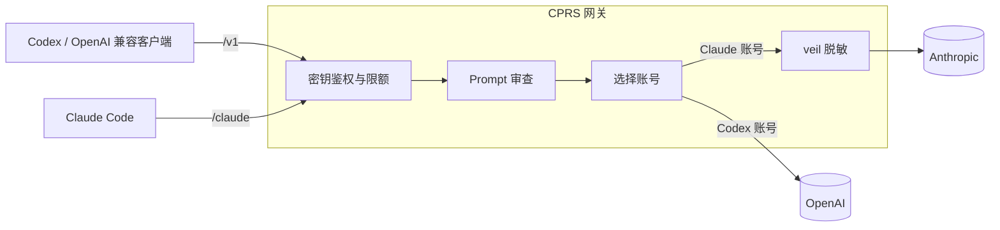

<!-- prettier-ignore -->
<div align="center">


# Codex Proxy RS

把多个 ChatGPT、Claude 订阅账号合成一个账号池，让 Codex 和 Claude Code 通过同一个网关使用

[](https://github.com/Gululu8023/codex-proxy-rs/actions/workflows/ci.yml)
[](https://github.com/Gululu8023/codex-proxy-rs/actions/workflows/docker-image.yml)
[](https://github.com/Gululu8023/codex-proxy-rs/pkgs/container/codex-proxy-rs)
[](LICENSE)

[能做什么](#能做什么) · [工作原理](#工作原理) · [快速开始](#快速开始) · [客户端接入](#客户端接入) · [常见问题](#常见问题) · [文档](#文档)

</div>

Codex Proxy RS（CPRS）是一个自托管网关。你把手上的 ChatGPT 和 Claude 订阅账号登录进来，再给自己的电脑、同事或其他服务各发一个客户端密钥。Codex、Claude Code 只要连上网关，就由网关挑选合适的账号转发请求，同时记下每个密钥用了多少、花了多少钱。

> [!IMPORTANT]
> 本项目基于 [zyycn/codex-proxy-rs](https://github.com/zyycn/codex-proxy-rs) 二次开发，从 v4.0.0 起独立编号。数据库结构和源仓库**不兼容**，首次部署请使用全新的 PostgreSQL 和空的 Redis，原因见[初始化基线](backend/migrations/README.md#二开初始化基线)。

## 能做什么

**账号池**
- ChatGPT（Codex）和 Claude 账号用 OAuth 登录，也可以直接导入已有凭据
- 可以给每个账号指定独立的代理出口，并给账号分组
- 后台自动同步各账号的额度和可用模型，账号快用完或出错时会冷却，暂时不再分到请求
- 请求按额度、会话亲和和并发情况分配到账号，账号都忙时自动排队

**客户端密钥**
- 每个密钥可以单独限定：能用哪些供应商、哪些账号分组，日/周花费上限，并发数和每分钟请求数
- 密钥持有人用自己的 Key 登录管理端，就能查看自己的用量和额度，并复制现成的客户端配置

**客户端**
- **Codex**：支持 Responses 和 Chat Completions 接口，也支持生图和语音通话。配置可一键复制，也能导入 CC Switch
- **Claude Code**：走原生 Messages 接口，支持流式输出、token 计数和模型发现。CLI 和 VS Code 扩展共用一份 `settings.json`

**Claude 隐私保护**：发往 Anthropic 的文本先由内嵌的 [veil](deploy/claude/README.md) 替换掉密钥、令牌等敏感文本，响应回来时再还原。主密钥和映射库在首次启动时自动生成。

**Prompt 审查**：先用本地规则给请求打分，可以再交给一个独立的审核模型复核。可以只记录不拦截，先观察效果，再切到拦截模式。被上游拒绝的请求会进入学习队列，帮你整理出新规则，规则需要人工确认才会发布。

**运维**
- 按模型定价统计用量和费用，能查看请求日志、定位失败原因
- 支持备份数据库和 Claude 隐私存储，官方构建可以在管理端直接在线更新
- 通过 [CPR 互联](deploy/README.md#cpr-互联)，可以把另一台 CPRS 发出的密钥当作账号接入，共享它的账号池

## 工作原理



账号、密钥和请求记录保存在 PostgreSQL，并发、冷却和会话亲和等临时状态保存在 Redis，见[部署结构](deploy/README.md#部署结构)。

一次请求大致经过这几步：

1. **鉴权**：客户端带着管理端发的密钥访问网关，网关检查密钥是否启用、额度和并发是否超限
2. **审查**（可选）：Prompt 审查给请求打分，按策略放行、告警或拦截
3. **选号**：在密钥允许的账号范围内，综合额度、健康状况、并发和会话亲和挑一个账号；同一会话尽量留在同一个账号上，以命中缓存。账号都忙时排队等待
4. **转发**：用选中账号的凭据访问上游。Claude 请求在发出前还会经过 veil 脱敏
5. **记账**：响应结束后记录用量、费用和请求日志，计入密钥的日/周额度

上游临时出错时，网关会在保证不重复执行的前提下自动重试或换号；已经开始输出的请求不会被重放。

### 支持的账号

| 供应商 | 接入方式 |
| --- | --- |
| ChatGPT（Codex） | OAuth 登录；导入 `auth.json`、Access / Refresh Token、PAT；sub2api 导出；OpenAI 兼容的 API Key 上游 |
| Claude | Claude Pro / Max OAuth 登录；导入 Claude Code 凭据 |
| 另一台 CPRS | 作为 OpenAI API Key 账号接入，自动识别 [CPR 互联](deploy/README.md#cpr-互联) |

每个账号可以单独设置代理出口、分组、权重、并发上限和可用模型。导入格式见[账号 API](docs/api.md#账号能力导入与-oauth)。

## 快速开始

用 Docker Compose 部署，PostgreSQL 和 Redis 会一起启动。

| 项目 | 要求 |
| --- | --- |
| 系统 | Linux amd64 或 arm64（不提供 Windows、macOS 部署包） |
| 软件 | Docker Engine、Docker Compose Plugin、curl、OpenSSL |
| 资源 | 低并发自用 1 GB 内存可以运行，建议参考[小内存优化](deploy/README.md#小内存优化)调整参数 |
| 网络 | 服务器需要能访问 OpenAI / Anthropic，或者给账号配置代理 |

> [!TIP]
> 一键安装默认使用 `main` 分支自动构建的 `latest` 镜像，只有 amd64 版本。arm64 机器请使用正式 [Release](https://github.com/Gululu8023/codex-proxy-rs/releases) 的镜像或二进制包，见[选择镜像标签](deploy/README.md#选择镜像标签)。

### 一键安装

当前用户要能使用 Docker，并能通过 `sudo` 或 root 设置目录权限：

```bash
curl -fsSL https://raw.githubusercontent.com/Gululu8023/codex-proxy-rs/main/deploy/install.sh -o install.sh && bash install.sh
```

脚本会在当前目录下创建 `codex-proxy-rs/`，下载部署文件、生成密码并启动服务。结束时会显示访问地址和管理员密码，请记下来。

可以用环境变量调整安装行为：

| 变量 | 用途 | 默认值 |
| --- | --- | --- |
| `INSTALL_DIR` | 安装目录，建议写绝对路径 | 当前目录下的 `codex-proxy-rs/` |
| `CPR_RELEASE_TAG` | 安装指定 Release 版本 | 跟随 `main` 分支 |
| `ADMIN_PASSWORD` | 管理员初始密码，至少 12 位，不能包含 `$`，也不能是常见弱口令 | 随机生成 |

```bash
INSTALL_DIR="$HOME/services/codex-proxy-rs" bash install.sh
```

在已有安装目录里再次运行脚本，不会改动现有配置，也不会升级版本。想自己一步步部署，请看[手动安装](deploy/README.md#手动安装)。

### 升级

在安装目录执行：

```bash
docker compose -f deploy/compose.yaml pull
docker compose -f deploy/compose.yaml up -d
```

请保留 `.runtime/data` 目录。Claude 隐私处理的主密钥和映射库都存在这里，丢失后之前的 Claude 会话将无法继续。跨版本升级前先看[升级说明](deploy/README.md#镜像升级与源码构建)。

### 开始使用

1. 打开 `http://127.0.0.1:8080`，用 `admin@cpr.local` 和管理员密码登录。默认只能在服务器本机访问，要从其他设备使用，请配置 [HTTPS 反向代理](deploy/README.md#公网访问)
2. 在「账号管理」中选择供应商，登录或导入账号
3. 在「API密钥」中创建客户端密钥，勾选它能用的供应商。不选分组，就能使用权限范围内的全部账号
4. 点密钥的「使用密钥」，复制配置到客户端

## 客户端接入

| 客户端 | 地址 | 配置文件 |
| --- | --- | --- |
| Codex CLI / 桌面端 | `http://127.0.0.1:8080/v1` | `~/.codex/config.toml` |
| Claude Code CLI / VS Code | `http://127.0.0.1:8080/claude`（**不要加 `/v1`**） | `~/.claude/settings.json` |
| 其他 Responses / Chat Completions 客户端 | `http://127.0.0.1:8080/v1` | 按客户端填写 |

远程使用时，把 `http://127.0.0.1:8080` 换成网关的 HTTPS 地址。API Key 一律填管理端创建的客户端密钥；Claude Code 使用的密钥需要开通 Anthropic 权限。

查询某个密钥能用哪些模型：

```bash
curl http://127.0.0.1:8080/v1/models \
  -H 'Authorization: Bearer <client-api-key>'
```

具体配置、生图、语音和排障见[客户端配置](deploy/README.md#客户端配置)。

## 常见问题

<details>
<summary><b>能从 zyycn/codex-proxy-rs 或旧版本直接升级过来吗？</b></summary>

不能。CPRS 使用独立的数据库初始化基线，需要全新的 PostgreSQL 和空的 Redis。账号需要在新实例中重新登录或导入凭据，密钥和用量历史不会迁移。
</details>

<details>
<summary><b>能部署多个实例做负载均衡吗？</b></summary>

不能，只支持单副本。并发租约、后台任务和在线更新都按单实例设计。多台机器之间想共享账号，可以用 [CPR 互联](deploy/README.md#cpr-互联)。
</details>

<details>
<summary><b>显示的费用是真实账单吗？</b></summary>

不是。订阅账号没有按量账单，网关按模型的 API 价格估算"等价费用"，用来比较各密钥的用量和设置额度上限。价格可以在管理端同步或手动调整。
</details>

<details>
<summary><b>Claude 请求为什么一定要经过 veil？它坏了会怎样？</b></summary>

veil 在请求离开网关前把密钥、令牌等敏感文本换成占位符，减少发给 Anthropic 的敏感内容。为了不出现"有时保护、有时不保护"的情况，veil 不可用时 Claude 入口会直接拒绝请求，不会发送原文。Codex 链路和管理端不受影响。详见 [Claude 接入与隐私保护](deploy/claude/README.md)。
</details>

<details>
<summary><b>需要备份哪些东西？</b></summary>

管理端可以把数据库和 Claude 隐私存储定时备份到 S3 / R2。另外两样需要自己保管：`deploy/config.yaml`，以及 Claude 隐私存储的主密钥 `.runtime/data/veil/master.key`。主密钥不进入任何自动备份，丢失后已有的 Claude 会话无法恢复。详见[备份与恢复](deploy/README.md#备份与恢复)。
</details>

<details>
<summary><b>Codex 一直提示要登录，或者没有生图工具？</b></summary>

通常是配置没生效：确认 Codex 实际读取的配置目录、选中的 Provider，以及 `requires_openai_auth = false` 和 `X-OpenAI-Actor-Authorization` 头都在，然后完全退出重启。完整排查表见[登录与生图排查](deploy/README.md#登录与生图排查)。
</details>

## 使用须知

- 请遵守 OpenAI 和 Anthropic 的服务条款。账号共享方式是否被允许、由此产生的风险，由部署者自行判断和承担
- 账号凭据以明文保存在 PostgreSQL 中。数据库、备份和 `.runtime/` 目录都要按密码级别保护，公网访问务必使用 HTTPS
- 本项目与 OpenAI、Anthropic 没有关联

## 文档

| 想做什么 | 看这里 |
| --- | --- |
| 部署、备份、恢复、升级 | [部署文档](deploy/README.md) |
| 接入 Claude、了解隐私处理 | [Claude 接入与隐私保护](deploy/claude/README.md) · [Claude 账号管理](docs/claude-account-management.md) |
| 配置 Prompt 审查 | [Prompt 审查](deploy/README.md#prompt-审查) |
| 对接接口 | [API 参考](docs/api.md) |
| 二次开发 | [开发指南](docs/development.md) · [系统架构](docs/architecture.md) · [数据库迁移](backend/migrations/README.md) · [UI 组件库](https://github.com/zyycn/codex-proxy-ui) |
| 提交代码、发版 | [贡献指南](CONTRIBUTING.md) · [发行指南](docs/releasing.md) |

技术栈：后端为 Rust（Tokio、Axum、SQLx），前端为 Vue 3、Vite、Tailwind CSS 4，存储使用 PostgreSQL 18 和 Redis 8。

## 致谢

感谢 [zyycn/codex-proxy-rs](https://github.com/zyycn/codex-proxy-rs) 原作者打下的基础，也感谢 [LINUX DO](https://linux.do) 社区。

## 许可证

[Apache License 2.0](LICENSE)
