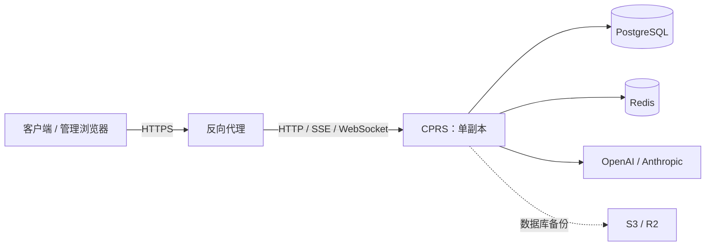

# 部署与运维

第一次安装建议直接用[一键安装](../README.md#一键安装)。本文是完整的部署手册：手动安装、客户端配置、日常设置、升级、备份和排障。

下文命令都在安装目录 `codex-proxy-rs/` 下执行。`deploy/` 放 Compose 文件和配置，`.runtime/` 放所有持久化数据。

| 想做什么 | 看这里 |
| --- | --- |
| 安装 | [手动安装](#手动安装) · [Linux 二进制部署](#linux-二进制部署) · [启动与健康检查](#启动与健康检查) · [公网访问](#公网访问) |
| 接入客户端 | [Claude Code](#claude-code) · [Codex](#codex-cli--桌面端) · [生图与语音](#生图和-websocket) · [客户端排查](#登录与生图排查) |
| 调整设置 | [运行设置](#启动后的运行设置) · [部署时区](#部署时区) · [Prompt 审查](#prompt-审查) · [CPR 互联](#cpr-互联) · [代理管理](#代理管理) · [小内存优化](#小内存优化) |
| 维护 | [数据与日志](#持久化与备份) · [请求排查](#请求错误排查) · [密码轮换](#密码与轮换) · [停止与重启](#停止与重启) |
| 升级与恢复 | [镜像升级](#镜像升级与源码构建) · [在线更新](#管理端在线更新) · [备份与恢复](#备份与恢复) |

Claude 专属的接入方式和隐私存储见 [Claude 接入与隐私保护](claude/README.md)；本地开发见[开发文档](../docs/development.md)。

## 部署结构



- CPRS **只支持单副本**，不能靠多开容器扩容
- 网关、PostgreSQL、Redis 默认只绑定本机 `127.0.0.1`，对外访问通过反向代理，数据库和 Redis 不要暴露到公网
- PostgreSQL 保存所有业务数据：账号、密钥、设置、请求记录和审计；Redis 只保存可以重建或会过期的协调状态，如会话亲和、并发租约、冷却和登录会话

### 配置放在哪

| 位置 | 内容 | 修改方式 |
| --- | --- | --- |
| `deploy/config.yaml` | 监听地址、数据库和 Redis 连接、管理员初始密码、时区、日志等启动配置 | 编辑后重启。升级时与新模板合并，不要整份覆盖 |
| `deploy/compose.yaml` | 镜像、端口、挂载、PostgreSQL 启动参数 | 修改后重建对应容器 |
| PostgreSQL | 账号、密钥、运行设置、上游身份等 | 管理端 |
| 浏览器本地 | 主题和界面偏好 | 管理端主题设置 |

项目不使用 `.env` 文件。CPRS 从当前目录向上查找 `deploy/config.yaml`，配置里的相对路径都以这个文件所在目录为准。未知字段会在启动时提示字段名并忽略，缺少必填项会直接停止启动。

## 手动安装

一键安装脚本就是在自动执行这一节。默认使用 `main` 分支自动构建的 `latest` 镜像，它只有 Linux amd64 版本；arm64 机器请改用 [Release](https://github.com/Gululu8023/codex-proxy-rs/releases) 附带的部署文件和版本号镜像。

需要 Docker Engine、Docker Compose Plugin、curl 和 OpenSSL，当前用户能使用 Docker，并能通过 `sudo` 或 root 设置目录权限。

**1. 下载部署文件并创建目录**

```bash
mkdir -p codex-proxy-rs/deploy && cd codex-proxy-rs

CPR_SOURCE=https://raw.githubusercontent.com/Gululu8023/codex-proxy-rs/main/deploy
curl -fsSL "${CPR_SOURCE}/compose.yaml" -o deploy/compose.yaml
curl -fsSL "${CPR_SOURCE}/config.example.yaml" -o deploy/config.example.yaml

install -d -m 0750 .runtime/postgres .runtime/redis
sudo install -d -m 0770 -o "$(id -u)" -g 10001 .runtime/data .runtime/logs
sudo install -m 0640 -o "$(id -u)" -g 10001 deploy/config.example.yaml deploy/config.yaml
```

应用容器以 `10001:10001` 身份运行，所以数据目录、日志目录和配置文件要让 `10001` 组可读写。部署文件和镜像要配套：`main` 的模板配 `latest` 镜像，Release 的模板配该版本镜像，不要混用。

**2. 填写密码**

为 PostgreSQL 和 Redis 各生成一个密码：

```bash
openssl rand -hex 24
openssl rand -hex 24
```

分别填到 `deploy/config.yaml` 的 `store.database.password` 和 `store.redis.password`，再设置 `admin.default_password`（管理员初始密码，至少 12 位，不能是常见弱口令，不能包含 `$`）。

密码要求 16–128 字节，不能包含控制字符。推荐用上面的十六进制随机串，可以避开 Compose 对 `$` 的变量替换。Compose 会从 `config.yaml` 读取这些密码，不需要另外导出环境变量，也不要把密码写进连接 URL。如果要通过环境变量提供，使用 `CPR_DATABASE_PASSWORD` 和 `CPR_REDIS_PASSWORD`，填原始密码即可，不需要 URL 编码。

**3. 按需调整登录有效期**

| 配置 | 含义 | 默认 |
| --- | --- | --- |
| `admin.session_ttl_minutes` | 管理员多久不活动后需要重新登录 | 模板为 7 天 |
| `admin.session_absolute_ttl_minutes` | 管理员从登录起最长有效期 | 30 天 |
| `client.session_ttl_minutes` | 用 API Key 登录管理端（查看自己用量）的有效期，不随活动续期 | 1 天 |

修改后重启生效，不会延长已有会话。登录协议见[认证 API](../docs/api.md#统一登录与会话)。

**4. 启动**：见[启动与健康检查](#启动与健康检查)。

### Redis ACL 用户

默认 Redis 使用 `default` 用户加密码。要连接已配置 ACL 用户的外部 Redis，把用户名写进 URL，密码仍单独填写：

```yaml
store:
  redis:
    url: 'redis://u1@redis-host:6379/0'
    password: &redis_password '<u1 的密码>'
```

用户名里的 `@`、`:` 等字符需要 URL 编码。注意 Compose 里设置的环境变量 `CPR_REDIS_URL` 优先于 `store.redis.url`，所以还要把 `compose.yaml` 中应用服务的 `CPR_REDIS_URL` 改成同样的地址，只改 `config.yaml` 不会生效。

## Linux 二进制部署

不想用 Docker 时，可以直接运行 Release 中的二进制包，提供 Linux amd64 和 arm64 两个版本。需要自己准备 PostgreSQL 和 Redis，并建好数据库和用户；要用数据库备份功能，还要把与服务端同版本的 `pg_dump` 放进 `PATH`。

从 [Release](https://github.com/Gululu8023/codex-proxy-rs/releases) 下载 `codex-proxy-rs_<version>_linux_<arch>.tar.gz` 和 `checksums.txt`，核对 SHA-256 后解压，保持 `codex-proxy-rs`、`web/dist`、`deploy` 的相对位置不变。进入解压目录，创建配置：

```bash
install -m 0600 deploy/config.example.yaml deploy/config.yaml
```

编辑 `deploy/config.yaml`：填写 `store.database`、`store.redis` 的地址和密码以及 `admin.default_password`，再合并以下内容：

```yaml
host:
  system_update:
    deployment_mode: binary
    self_restart_enabled: true
api:
  asset_directory: '../web/dist'
```

启动：

```bash
./codex-proxy-rs serve
```

访问 `http://127.0.0.1:8080` 登录，`Ctrl+C` 停止。官方构建支持在管理端[在线更新](#管理端在线更新)，前提是安装目录和 `.runtime` 可写。手动换版本时先停服并备份旧文件，再整体替换可执行文件和 `web/dist`，保留 `deploy/config.yaml` 和 `.runtime`。

## 启动与健康检查

```bash
docker compose -f deploy/compose.yaml config --quiet
docker compose -f deploy/compose.yaml pull
docker compose -f deploy/compose.yaml up -d --no-build --wait
docker compose -f deploy/compose.yaml ps
```

CPRS 要先跑完数据库迁移才开始监听 HTTP。迁移期间日志每 15 秒报告一次已等待时间，这段时间访问不了是正常的，不要反复重启。镜像默认给了 5 分钟启动宽限期；数据量很大时，适当调大 `healthcheck.start_period` 和部署工具的等待时间。

两个健康检查接口：

| 接口 | 用途 |
| --- | --- |
| `GET /readyz` | 能否接流量。负载均衡或服务注册用它判断是否转发请求，就绪时返回 `204` |
| `GET /healthz` | 综合健康，包括文件日志、后台任务等。镜像和 Compose 默认用它做容器健康检查，建议同时接入监控告警 |

`/healthz` 返回 `503` 时，具体故障会记录在管理端的运维错误里（组件 `health`，关联 ID 以 `probe:` 或 `worker:` 开头）。状态码说明见[健康检查 API](../docs/api.md#2-健康检查)。

> [!WARNING]
> `docker compose config`（不带 `--quiet`）和 `docker inspect` 的输出包含数据库和 Redis 密码，不要原样贴到工单或群里。

## 公网访问

Compose 默认只监听 `127.0.0.1`。要从其他设备访问，在前面加一层 HTTPS 反向代理。反向代理需要：

- 保留 `Authorization` 和浏览器的 `Origin` 头，不要改写 Cookie 的 `Secure` 属性（HTTPS 反代用 HTTP 回源没问题）
- 允许 `/v1/responses` 和 `/v1` 下语音控制的 WebSocket Upgrade
- 关闭响应缓冲（SSE 流式输出需要）
- 读取超时足够长，覆盖长时间生成和排队等待，建议 1 小时左右

可以参考 [nginx.conf.example](claude/nginx.conf.example) 中的 `location /` 段。客户端地址是部署地址加路径：Codex 用 `/v1`，Claude Code 用 `/claude`。

管理端登录支持 HTTP，但 HTTP 不加密，公网部署请用 HTTPS。

### 超时与保活

| 链路 | 行为 |
| --- | --- |
| 模型请求总时长 | 默认不限制。`api.request_timeout_seconds`（默认 `null`）只限制 HTTP 返回响应头之前的等待 |
| CPRS → OpenAI 上游流 | 默认 300 秒没有数据视为断流（WebSocket 由 `openai.ws_pool.stream_idle_timeout_ms` 控制） |
| CPRS → 客户端 SSE | 每 15 秒没有输出就发一条 SSE 注释保活，并带上 `X-Accel-Buffering: no` |
| CPRS ↔ 客户端 WebSocket | 每 25 秒发 Ping，首个 Ping 发出后 30 秒没有任何入站数据就断开 |
| CPRS ↔ OpenAI 上游 WebSocket | 每 25 秒发 Ping，不因等不到 Pong 主动断开 |

保活只针对客户端到 CPRS 这一段，不会延长账号出站代理的读取超时，也不会重置 Codex 自己等待完整事件的超时。

### 上游 WebSocket 连接池

Codex OAuth 账号默认用 WebSocket 连接 OpenAI，CPRS 会复用这些连接：

| 配置 | 默认 | 说明 |
| --- | --- | --- |
| `openai.ws_pool.idle_timeout_ms` | 5 分钟 | 没被客户端占用的空闲连接多久后关闭 |
| `openai.ws_pool.max_age_ms` | 55 分钟 | 连接最长寿命，到期后不再复用，但不会打断正在生成的响应 |

在「代理管理」里可以给每个代理设置"上游 WS 连接上限"，限制单个 CPRS 通过这个代理建立的 OpenAI WebSocket 总数（默认不限）。上限要按代理的实际容量设置，并给 HTTP 等其他流量留余量，比如 32 并发的代理可以设 24。达到上限时优先关闭最久没用的空闲连接，没有可关的就排队等待。

### Codex 报 `error decoding response body`

这表示客户端读取 HTTP 响应体时连接断了，不一定是 JSON 格式问题。用网关请求诊断里的 `upstream.read.failed`、`downstream.body.closed` 和反向代理日志判断是哪一段断开的。如果报的是 `idle timeout waiting for SSE`，检查客户端的 `stream_idle_timeout_ms`。

## 客户端配置

所有客户端都使用管理端「API 密钥」中创建的密钥，不是上游账号的凭据。点密钥的「使用密钥」可以直接复制对应客户端的配置。

### Claude Code

1. 在管理端确认 Claude 隐私状态为"就绪"（首次启动会自动准备，见 [Claude 接入](claude/README.md)）
2. 在「账号管理」添加 Claude 账号，用 OAuth 登录或导入 Claude Code 凭据
3. 创建开通了 Anthropic 权限的密钥

在「使用密钥」中选择 Claude Code 和操作系统，把配置合并到 `~/.claude/settings.json`（Windows 为 `%userprofile%\.claude\settings.json`），CLI 和 VS Code 扩展共用这个文件。核心是两个环境变量：

| 变量 | 值 |
| --- | --- |
| `ANTHROPIC_BASE_URL` | `https://网关域名/claude`，本机可用 `http://127.0.0.1:8080/claude` |
| `ANTHROPIC_AUTH_TOKEN` | 管理端创建的密钥 |

Base URL **不要加 `/v1`**，客户端会自己拼 `/v1/messages`。Claude 用独立域名时的写法见 [Claude 公网入口](claude/README.md#公网入口)。导出的配置默认开启网关模型发现，不指定模型时客户端会从密钥可用的模型里选。

### Codex CLI / 桌面端

在「使用密钥」中按操作系统复制 `config.toml`，合并到用户配置目录：Linux/macOS 是 `~/.codex/`，Windows 是 `%USERPROFILE%\.codex\`，设置了 `CODEX_HOME` 时以它为准。合并前先备份，合并后完全退出再重启 Codex。不需要 `auth.json`，原来的官方登录文件可以留着。

完整示例，替换地址、密钥和模型即可：

```toml
model_provider = "OpenAI"
model = "gpt-5.6-terra"
review_model = "gpt-5.6-terra"
model_reasoning_effort = "max"
service_tier = "default"
# 语音通话控制地址
experimental_realtime_ws_base_url = "http://127.0.0.1:8080/v1"

[model_providers.OpenAI]
name = "OpenAI"
base_url = "http://127.0.0.1:8080/v1"
model_catalog_url = "http://127.0.0.1:8080/v1/models"
wire_api = "responses"
supports_websockets = false
requires_openai_auth = false
# 代理密钥
experimental_bearer_token = "<client-api-key>"

[model_providers.OpenAI.capabilities]
# V2 远程压缩
remote_compaction = "v2"

[model_providers.OpenAI.http_headers]
# 服务端托管认证，让客户端开放原生生图工具
X-OpenAI-Actor-Authorization = "proxy-managed"

[features]
image_generation = true
goals = true
```

注意事项：

- `OpenAI` 是自定义 Provider ID，要和 `model_provider` 大小写一致。如果改成别的 ID（比如 `custom`），下面的 `capabilities`、`http_headers` 表名也要跟着改
- 合并时修改已有的表，不要重复添加 `[features]` 或 Provider 表
- 换模型时确认它支持所选的推理强度
- 换网关地址时，`base_url`、`model_catalog_url`、`experimental_realtime_ws_base_url` 要一起改
- 文件里的密钥是明文，不要提交到 Git

**CC Switch**：「使用密钥」也能生成 CC Switch 一键导入，包含连接信息和每 30 分钟刷新一次的额度查询。但导入的配置**不含**远程压缩、生图、WebSocket 和语音设置，需要这些功能请用上面的 `config.toml` 直接配置。在 CC Switch 里改了地址或密钥后，要重新导入才能同步额度查询。

**固定模型目录**：在账号的模型列表中导出所选 Codex 模型，然后在 `config.toml` 顶层设置 `model_catalog_json = "/absolute/path/to/cpr-model-catalog.json"`。这是一次性快照，模型变化后要重新导出。

### 生图和 WebSocket

模板默认开启原生生图：Codex 需要图片时会调用生图工具，网关转给 Images 接口处理。生图需要三个条件同时满足：客户端支持、对话模型支持图片输入、服务端有带生图权限和额度的 Codex 账号。Claude 账号不处理生图请求。

生图不依赖 WebSocket。要让客户端用 WebSocket 连网关，把 `supports_websockets` 改成 `true`，并确认反向代理允许 Upgrade。

客户端到网关、网关到上游是两段独立连接。客户端关掉 WebSocket，网关照样可以用 WebSocket 连上游。如果你的 Codex 账号都固定为 SSE 传输，客户端也保持 `supports_websockets = false`，免得每次先试 WebSocket 再回退。

### 语音通话

Codex 的 `/voice` 用 Provider 的 `base_url` 创建通话，但控制连接用的是顶层的 `experimental_realtime_ws_base_url`，**不会**自动继承 Provider 地址。两者都要指向网关的 `/v1`，并确保反向代理允许 WebSocket。

`experimental_realtime_ws_base_url` 必须写在第一个 `[表]` 之前。如果创建通话成功后报 `realtime websocket handshake failed`，看客户端日志里 `connecting realtime websocket` 连的是哪里，还是 `api.openai.com` 就说明配置没生效。

语音使用有权限的 OAuth 账号，音频流在客户端和上游之间直接传输。路由和限制见 [Codex Live 语音通话](../docs/api.md#codex-live-语音通话)。

### 时区与客户端环境信息

想让模型看到的位置和时区与服务器一致（而不是你本机的），在管理端开启全局请求位置，或给账号的代理设置位置，代理位置优先。`host.timezone` 只管管理端的时间显示和统计，不影响这里。只对 OpenAI 请求生效。

Codex 回答还是显示本机时区时：

- 开一个新会话再问，避免历史回答干扰
- 检查请求是否真的用了预期的账号和代理
- 如果模型是调用 `date` 之类的工具查的，结果当然是真实系统时区，覆盖不会改你的操作系统

字段规则见[代理位置](../docs/api.md#独立代理管理--managed-proxies)。位置覆盖不等于匿名化，请求里的工作目录、Git 信息等仍会发给上游。

Codex 客户端还会自己往 OpenAI 发统计数据，不经过网关。要关掉，在 `config.toml` 加上：

```toml
[analytics]
enabled = false

[otel]
metrics_exporter = "none"
```

### 登录与生图排查

| 现象 | 检查 |
| --- | --- |
| 仍提示登录 | 确认 Codex 实际读的是哪个配置目录、选中的 Provider 和 `requires_openai_auth = false`，完全退出后重启 |
| 没有生图工具 | 确认实际生效的 Provider 带了 `X-OpenAI-Actor-Authorization` 头且 `requires_openai_auth = false`。CC Switch 导入不含生图设置。本地缓存的免费账号登录也可能影响，先备份再排查，不要直接删光登录状态 |
| 调用了生图但失败 | 看服务端账号的权限、额度和请求错误，文字对话正常不代表能生图 |
| `401` | 密钥错误或已停用。Actor 头不能代替密钥 |
| `400 client_version_too_old` / `client_version_unavailable` | 客户端版本低于管理员设置的最低版本，或反向代理丢了版本头。规则见[版本门禁](../docs/api.md#1-鉴权与公共约定) |
| 地址里有 `5173/dev/v1` | 这是前端开发服务地址，日常使用请改成网关地址 |

其他兼容 Responses API 的客户端，填 `/v1` 地址和密钥即可，不需要 Actor 头。接口细节见 [API 参考](../docs/api.md#3-openai-数据面与模型目录)。

## 启动后的运行设置

下面这些在管理端修改，保存后对新请求生效，不会被重启覆盖：

| 设置 | 位置 | 说明 |
| --- | --- | --- |
| 上游客户端身份 | 系统设置 → 上游配置 → 客户端身份 | 网关以什么客户端身份访问上游。密钥可以单独覆盖，OpenAI 密钥还能设[安装身份种子](../docs/api.md#key-客户端身份) |
| 并发与排队 | 系统设置 → 运行设置 | 密钥和账号各自的排队容量和超时，可选择账号排队失败后换号，见[排队规则](../docs/api.md#并发与排队) |
| 全局请求位置 | 系统设置 → 上游配置 → 请求位置覆盖 | 默认关闭 |
| 代理位置 | 代理管理 | 优先于全局位置 |

位置覆盖只改 OpenAI 请求里的位置和时区字段，不改真实出口 IP 和系统时间。

另有两个只能在 `config.yaml` 里设置的 OpenAI 请求头，修改后需要重启：`openai.residency` 对应 `x-openai-internal-codex-residency`，`openai.account_routing_override` 对应 `x-openai-account-routing-override`。填了就原样发送并覆盖客户端的同名头，留空则删除该头。字段见[运行设置 API](../docs/api.md#8-运行设置)。

### 部署时区

在 `deploy/config.yaml` 中设置 IANA 时区，默认 `Asia/Shanghai`：

```yaml
host:
  timezone: 'Asia/Shanghai'
```

它决定管理端显示的时间、按天统计、密钥的日/周限额、账号预热和备份计划的时间点，也决定日志文件按哪天切分。浏览器时区、进程 `TZ` 和数据库时区都不会影响它。填错时区名会阻止启动，修改后重启生效。

中途切换时区不会清零已经开始的限额窗口，当前窗口到期后按新时区计算下一个；备份计划从切换时刻起按新时区排期，不补跑错过的任务。

### Prompt 审查

「Prompt 审查」页面可以在请求发往上游前给 Prompt 打分，提前拦截可能被上游内容政策拒绝的请求。Codex 和 Claude 请求都适用。

- **模式**：`observe` 只记录、不拦截，适合先观察效果；`enforce` 按策略处置
- **本地规则**：命中后告警或阻断；开启"严格终止"后，严格规则单独计分，达到阈值直接拦截
- **外部复核**（可选）：再交给一个独立的审核模型判断，支持 Chat Completions 或 Moderations 接口。复核用的是你单独配置的 Key，不占用订阅账号。Claude 请求送审前同样先经过 veil 脱敏
- **学习队列**：被上游以内容政策拒绝的请求，会以脱敏后的证据进入学习队列，可以据此生成规则草稿。**草稿必须人工审核发布**，不会自动生效。使用 Moderations 复核时，生成草稿还需要另配一个同服务商的对话模型

审查记录跟随请求记录的保留期，不保存原文和匹配片段。页面会显示缺少摘要的记录数，缺摘要不代表审查通过。配置字段见 [Prompt 审查 API](../docs/api.md#prompt-审查)，规则来源与许可见 [NOTICE](../backend/crates/gateway-host/src/prompt_guard/NOTICE.md)。

### CPR 互联

CPR 互联让一台 CPRS（下游）把另一台 CPRS（上游）发出的密钥当作账号使用，相当于借用对方的账号池。

**上游**：在「API 密钥」中为专用密钥选择账号分组并开启「CPR 互联」。下游会共享这个密钥的预算、并发和 RPM 限制，你也可以选择是否公开账号池、额度和套餐信息。共享密钥只会使用这些分组中的直连 OAuth 账号，分组里的 API Key 转供账号不参与。Claude 账号不参与互联。

**下游**：导入或编辑一个 OpenAI API Key 账号，填上游的 API 地址和这个密钥，后台会自动识别互联能力。地址有自定义前缀时保留完整前缀。识别成功显示 `CPR`，上游关闭共享或不支持互联时显示 `API`，可以点「刷新额度」重新识别。

上游明确报告密钥预算用完时，下游暂停这个账号，之后同步确认恢复再自动启用。上游额度只用于展示和选号参考，不保证下次请求一定成功。两端都需要 CPR Link v3，第三方网关实现同一协议也能识别。协议见 [CPR 互联 API](../docs/api.md#cpr-互联只读协议)。

### 代理管理

每个账号可以单独指定出站代理，账号的推理、OAuth 登录与续期、额度和模型查询都走这个出口。

- **直连**不会继承 `HTTP_PROXY`、`HTTPS_PROXY`、`ALL_PROXY` 等环境变量。版本更新检查等后台请求仍然使用部署环境的代理
- **指定的代理不可用时请求直接失败**，不会退回直连
- **禁用代理**后，使用它的账号暂时改为直连，重新启用后恢复

**添加代理**：在「代理管理 → 新增代理」中切换到"批量"，每行一个，支持完整 URL、`host:port` 或 `host:port:用户名:密码`，一次最多 100 条。简写格式使用表单里选的协议，IPv6 地址要加方括号。勾选"添加后测试"会顺便测试新添加的代理。格式错误或重复的条目会跳过，不影响其他条目。网络中断导致结果不确定时，先刷新列表核对，不要直接重复添加。

**测试**：列表里可以跨页勾选后批量测试，同时检测连通性和出口地区。编辑账号时也可以在"出站隧道"旁点"测试出口"，结果显示延迟和 IPv4/IPv6 出口。出口测试只看网络，不验证账号权限，账号可用性请用账号的连接测试。

**分配账号**：在代理列表点关联账号数，再点"分配账号"，可以跨页勾选，一次最多 1000 个。被分配的账号原来的代理会被替换，其他设置不变。

**Docker 里使用宿主机代理**：添加 `http://host.docker.internal:7890`（端口按实际修改）。Compose 已把这个名字映射到宿主机，但宿主机的代理需要监听在容器能访问的地址上，只监听 `127.0.0.1` 不行。

### 小内存优化

1 GB 内存、网关和数据库同机、低并发的部署，可以从下面的参数起步调整。这些只是调优起点，不是内存上限保证。先记录实际负载下的内存峰值，优先缩小数据库连接池和缓冲，再考虑 Redis 和应用侧。

| 调整对象 | 配置位置 | 生效方式 |
| --- | --- | --- |
| 应用空闲内存回收 | `config.yaml` → `services.app-runtime.environment.GLIBC_TUNABLES` | 重建应用容器 |
| 应用数据库连接池 | `config.yaml` → `store.pool.max_connections` | 重启应用 |
| PostgreSQL 内存 | `compose.yaml` → `services.postgres.command` | 重建 PostgreSQL 容器 |
| Redis 持久化 | `config.yaml` → `services.redis-credentials.command` | 重建 Redis 容器 |

以下片段都要**合并**到已有节点，不要重复创建顶层的 `store` 或 `services`，也不要覆盖凭据、挂载和健康检查。

**应用空闲内存回收**（默认关闭）：让 glibc 更积极地把请求结束后的空闲内存还给系统，代价是略增 CPU。

```yaml
services:
  app-runtime:
    environment:
      GLIBC_TUNABLES: 'glibc.malloc.mmap_threshold=131072:glibc.malloc.trim_threshold=131072'
```

关闭时把值改回 `''`。如果已经有别的 `GLIBC_TUNABLES`，用冒号合并。二进制部署不读这一段，需要在启动命令前设置同名环境变量。参数含义见 [glibc 文档](https://sourceware.org/glibc/manual/latest/html_node/Memory-Allocation-Tunables.html)。

**应用连接池**：默认 20，最小 2。调小可以限制数据库连接数，但请求、后台任务和管理查询之间会更容易排队；出现连接获取超时就调大。

```yaml
store:
  pool:
    max_connections: 5
```

**PostgreSQL**：把 `compose.yaml` 中 `services.postgres.command` 替换为下面的列表，保留两个 UTC 参数：

```yaml
command:
  - postgres
  - -c
  - timezone=UTC
  - -c
  - log_timezone=UTC
  - -c
  - shared_buffers=64MB
  - -c
  - max_connections=30
  - -c
  - work_mem=2MB
  - -c
  - maintenance_work_mem=32MB
  - -c
  - autovacuum_work_mem=16MB
  - -c
  - max_parallel_workers_per_gather=0
```

服务端 `max_connections` 要大于应用连接池，并给备份和维护留余量。缩小这些预算可能让统计和维护任务变慢、产生更多临时文件。参数说明见 [PostgreSQL 文档](https://www.postgresql.org/docs/18/runtime-config-resource.html)。

**Redis**：默认开启 AOF。关闭定时 RDB 快照可以减少快照时的内存峰值：

```yaml
services:
  redis-credentials:
    command:
      - redis-server
      - --appendonly
      - 'yes'
      - --save
      - ''
      - --requirepass
      - *redis_password
      # 确认实际用量远低于 64 MiB 后再取消注释
      # - --maxmemory
      # - 64mb
      # - --maxmemory-policy
      # - noeviction
```

`--save` 后的空字符串必须保留。如果设置 `maxmemory`，淘汰策略只能用 `noeviction`，**不要用 `allkeys-lru` 之类会提前删键的策略**：Redis 里存的是租约、冷却和登录会话，被删掉会直接影响调度和登录。

**让配置生效**：`docker compose restart` 不会更新启动参数和环境变量，需要重建容器。改数据库参数要短暂停服：

```bash
docker compose -f deploy/compose.yaml config --quiet
docker compose -f deploy/compose.yaml stop codex-proxy-rs
docker compose -f deploy/compose.yaml up -d --no-build --no-deps --force-recreate --wait postgres redis
docker compose -f deploy/compose.yaml up -d --no-build --no-deps --force-recreate --wait codex-proxy-rs
```

只改应用配置时，只执行最后一条。之后可以用 `psql` 的 `SHOW ...`、`redis-cli --askpass INFO memory` 和 `docker compose stats --no-stream` 核对实际值和内存占用，并观察是否出现连接超时、Redis OOM 或容器重启。

## 停止与重启

管理端重启、`SIGTERM`、`SIGINT` 的效果相同：立即停止接收新连接，正在进行的 HTTP、SSE、WebSocket 会被断开，客户端需要在新进程就绪后重连。后台的记录写入和清理有 `host.worker_shutdown_timeout_seconds`（默认 30 秒）收尾时间。

Compose 的 `stop_grace_period` 是 75 秒。调大后台收尾时间时，也要同步调大它，否则 Docker 会提前强杀进程。

强杀或清理失败时，本实例占用的账号并发名额会在 10 分钟后自动过期释放。

## 持久化与备份

### 数据目录

| 目录 | 内容 |
| --- | --- |
| `.runtime/data` | 会话锚点密钥、Claude 隐私存储（`veil/`）、更新状态、备份暂存 |
| `.runtime/logs` | 应用日志，以及按需开启的 OAuth 恢复记录和请求转储 |
| `.runtime/postgres` | PostgreSQL 数据 |
| `.runtime/redis` | Redis AOF |

`docker compose down` 不会删除这些目录；删除 `.runtime` 会永久丢失所有本地数据。

> [!IMPORTANT]
> 账号凭据以明文 JSON 存在 PostgreSQL 中。数据库、备份文件、`config.yaml` 和日志目录都要按凭据级别保护。

### 日志与保留窗口

开启文件日志（`host.logging.file.enabled`）后，日志写在 `.runtime/logs/`，文件名为 `codex-proxy-rs-<类别>.YYYY-MM-DD[.N].log[.gz]`：

| 类别 | 内容 | 保留配置 | 默认 |
| --- | --- | --- | --- |
| `application` | 普通应用日志 | `host.logging.file.retention_days` | 7 个完整自然日加当天 |
| `oauth-recovery` | OAuth 恢复记录（默认关闭） | 同上 | 同上 |
| `request-dump` | 完整请求/响应报文（默认关闭） | `host.logging.request_dump_retention_days`，可用小数 | 24 小时 |

- 日志**只按时间清理，不按数量或磁盘空间清理**，请自行监控磁盘余量
- 分片默认 20 MiB（`max_file_size_mb`），关闭的分片会压缩成 `.log.gz`，检索时要同时搜 `.log` 和 `.log.gz`
- **开启文件日志后，stdout 只输出启动信息**，`docker logs` 看不到业务错误不代表没出错
- 日志写入跟不上时会丢弃记录而不是阻塞请求，此时 `/healthz` 的 `file_logging` 会报告异常

**OAuth 恢复记录**（`host.logging.oauth_recovery`）会在每次成功拿到 OpenAI 令牌时把令牌写进独立文件，用于数据库故障时找回凭据。**请求转储**（`host.logging.request_dump`）会记录原始请求和响应。这两项都包含明文凭据和用户内容，只在必要时临时开启，并严格控制 `.runtime/logs` 的访问权限。

## 请求错误排查

1. **记下基本信息**：故障时间、网关版本、客户端名称与版本、走的是 HTTP、SSE 还是 WebSocket。分清"上游返回的错误"、"网关返回的错误"和"客户端显示的文字"，客户端的统一提示往往不是根因
2. **拿到请求 ID**：响应头里的 `x-gateway-request-id` 和 `x-request-id` / `x-oai-request-id`（WebSocket 错误在错误消息的 `headers` 里）。在管理端错误列表按 ID 和时间搜索
3. **看错误详情**：核对上游状态、发送状态、尝试次数和失败阶段。需要反馈时下载诊断包，包里的上游错误已经脱敏，但分享前仍要检查业务内容
4. **查日志**：在 `codex-proxy-rs-application.*.log(.gz)` 中按请求 ID 和时间搜索，关注 `attempt.started`、`attempt.failed`、`request.finished`
5. **找不到记录**：在"全部平台"下用 ID 搜索。还没选到账号就失败的请求不会出现在具体平台或账号的筛选里；鉴权失败、路由不存在等请求只记在运维错误中，没有模型请求记录
6. **最后手段**：在能控制访问范围的前提下临时开启 `host.logging.request_dump` 复现一次，用完立即关闭。转储含凭据和用户正文，只摘取必要片段并人工脱敏，不要上传整个日志目录

查询接口见 [API：Dashboard、用量与错误](../docs/api.md#10-dashboard用量与错误)。

## 密码与轮换

| 密码 | 何时生效 | 如何修改 |
| --- | --- | --- |
| `admin.default_password` | 只在首次创建管理员时使用 | 之后在「系统设置 → 安全与访问 → 管理员密码」修改，所有管理员会话随之失效 |
| `store.database.password` | 只在 PostgreSQL 数据目录为空、首次初始化时使用 | 先在 PostgreSQL 里改用户密码，再同步改 `config.yaml`，然后重启应用。只改配置会导致应用连不上数据库 |
| `store.redis.password` | 每次创建 Redis 容器时使用 | 改配置后重建 Redis 和应用容器，不需要删数据 |

轮换数据库或 Redis 密码请安排在维护窗口，避免过渡期间两边密码不一致。

## 镜像升级与源码构建

### 升级 Docker 部署

```bash
docker compose -f deploy/compose.yaml pull codex-proxy-rs
docker compose -f deploy/compose.yaml up -d --no-build --wait codex-proxy-rs
```

升级前先看目标版本的发布说明。每个 Release 都附带配套的 `config.example.yaml` 和固定到该版本的 `compose.yaml`：对比新模板，把需要的新配置合并进现有 `config.yaml`，保留已有的凭据和自定义项。不要用模板覆盖现有配置，也不要拿 `main` 的模板配旧镜像。

数据库会在启动时自动执行新增迁移。迁移执行后不能直接换回旧镜像，回退需要用升级前的数据库备份加对应的旧镜像。

> [!IMPORTANT]
> CPRS 使用独立的数据库初始化基线，**不能**从源仓库 zyycn/codex-proxy-rs 或旧定制版直接升级，必须用全新的 PostgreSQL 和空 Redis 部署。原因见[初始化基线](../backend/migrations/README.md#二开初始化基线)。

### 选择镜像标签

通过 `CPR_IMAGE` 环境变量选择镜像，默认是 `latest`：

| 标签 | 来源 | 平台 |
| --- | --- | --- |
| `latest` | `main` 分支每次 CI 通过后自动构建 | amd64 |
| `sha-<提交前 12 位>` | 同上，固定到某个提交，可用于回退 | amd64 |
| `stable` | 最新正式版 | amd64、arm64 |
| `<版本号>` | 对应 Release | amd64、arm64 |

```bash
CPR_IMAGE=ghcr.io/gululu8023/codex-proxy-rs:stable docker compose -f deploy/compose.yaml up -d --no-build --wait
```

升级后可以在管理端的版本信息或镜像 digest 里确认实际运行的版本。

### 从源码构建镜像

克隆仓库并准备好配置和数据目录后，在仓库根目录执行。构建过程会自动准备前端依赖和 veil 源码：

```bash
CPR_VERSION="$(ruby -ryaml -e 'puts YAML.load_file("release/version.yaml").fetch("version").delete_prefix("v")')" \
CPR_GIT_SHA="$(git rev-parse HEAD)" \
CPR_BUILD_TIME="$(date -u +%Y-%m-%dT%H:%M:%SZ)" \
docker compose -f deploy/compose.yaml build codex-proxy-rs
docker compose -f deploy/compose.yaml up -d --no-build --wait
```

前面三个变量只用于写入版本信息，可以省略。源码构建不支持管理端在线更新。

### 版本命名与升级规则

| 通道 | 版本格式 | 会收到的更新 |
| --- | --- | --- |
| Stable | `X.Y.Z` | 正式版 |
| RC | `X.Y.Z-rc.N` | RC、正式版 |
| Beta | `X.Y.Z-beta.N` | Beta、RC、正式版 |
| Alpha | `X.Y.Z-alpha.N` | Alpha、Beta、RC、正式版 |
| Exp | `X.Y.Z-exp.N` | 只收同一轮实验中编号更高的 exp |

- 管理端「系统更新」默认按当前运行版本匹配通道，可以临时切换通道检查，但不会保存，也不会自动下载
- 只在同一个大版本内更新，不会降级
- 预发行版在 GitHub 上标记为 Pre-release，不影响 `stable` 镜像
- **Exp 是实验线**：不同实验之间、实验版与正式版之间不保证数据库兼容。从 exp 换回正式版，需要先备份，再在新数据库里迁移业务数据

更新器读取更新仓库 `main` 分支的 `release/version.yaml` 中的 `published` 字段来发现新版本，再到对应 Release 核对安装包和校验文件，不需要 GitHub 令牌。GitHub 限流时稍后重试即可，也可以直接下载 Release 手动升级。

### 管理端在线更新

Linux amd64、arm64 的官方构建（Docker 或二进制）支持在管理端在线更新；源码构建会显示不支持的原因。

流程：点「下载更新」→ 操作日志显示下载、校验、安装进度 → 状态变为「待重启」→ 点「立即重启」后才切换到新版本。更新成功后旧文件保留为 `*.backup`，可以在管理端回滚。如果备份文件被替换或丢失，就不提供在线回滚，需要手动部署已核实的发行包。

二进制部署需要在 `config.yaml` 中开启自重启：

```yaml
host:
  system_update:
    deployment_mode: binary
    self_restart_enabled: true
    executable_path: '/opt/codex-proxy-rs/codex-proxy-rs'   # 可选，默认使用启动时的程序路径
```

修改后需要手动重启一次才生效。这三项也可以用环境变量 `CPR_DEPLOYMENT_MODE`、`CPR_ENABLE_SELF_RESTART`、`CPR_UPDATE_EXE_PATH` 设置，YAML 优先。

Compose 已预设好以下环境变量，一般不需要改：

| 变量 | 说明 |
| --- | --- |
| `CPR_UPDATE_REPOSITORY` | 更新来源仓库，格式 `owner/repo`，默认 `Gululu8023/codex-proxy-rs` |
| `CPR_GITHUB_API_BASE` | 固定为 `https://api.github.com/repos` |
| `CPR_UPDATE_EXE_PATH`、`CPR_WEB_DIST_DIR` | 容器内的程序和前端目录 |
| `CPR_ENABLE_SELF_RESTART` | 允许管理端重启；进程退出后由 Compose 的 `restart: unless-stopped` 拉起 |

更新状态和锁文件在 `.runtime/data/update-state.json`、`update.lock` 和 `update-tmp/`，排查更新问题时可以查看。部署时必须保留完整的程序和 `web/dist`，两者成套更新。

## 备份与恢复

### 备份什么、怎么备份

| 内容 | 方式 |
| --- | --- |
| 账号、密钥、设置、额度和用量汇总 | 管理端 S3/R2 业务备份 |
| Claude 隐私存储（映射库、标记文件、自定义规则） | 业务备份自动附带，与数据库归档同属一条记录 |
| Claude 隐私存储**主密钥** | **不进入任何自动备份**，单独加密保管 |
| 完整请求记录、诊断和审计历史 | PostgreSQL 整库备份，或停库后备份 `.runtime/postgres` |
| 部署配置 | 单独备份 `deploy/config.yaml` 和自定义的 `compose.yaml` |
| 日志 | 单独备份 `.runtime/logs` |

不要在 PostgreSQL 运行时直接复制数据目录当作备份。

### 备份内容与限制

管理端在「系统设置」里配置 S3/R2、定时计划和保留策略，备份文件为 `.sql.gz`。为了控制体积，**业务备份不包含**请求明细、诊断和审计日志：

- 恢复后，全局请求数、Token 和费用按小时汇总保留，可以看总量和趋势，但看不到单条请求，也不能按密钥或账号筛选
- 密钥当前日/周限额的已用额度会保留，恢复后可以继续使用
- 需要完整历史就用 PostgreSQL 整库备份

其他说明：

- 官方镜像自带与数据库同版本的 `pg_dump`；自己换了 PostgreSQL 版本要同步核对
- 备份先压缩暂存在 `.runtime/data/backup-staging`，磁盘需预留一份最大归档的空间（有 Claude 隐私存储时再加一份映射库压缩包）
- Claude 隐私存储已初始化时，每条备份会在数据库之后再导出 `.veil.tar.gz`，两个都上传成功才算完成。映射库只增不删，后导出的快照一定覆盖数据库可能引用的全部映射
- 统计数据重建期间备份会失败，等重建完成后重试
- OpenAI 的主动重置卡由上游保管，不在备份范围内

### 人工恢复数据库

目前没有在线恢复功能，需要离线操作。恢复前确认备份和程序属于同一个发行线，源仓库或旧定制版的备份不能用于 CPRS。

1. 先备份现有数据库，**停止应用**
2. 核对归档的 SHA-256 与备份记录一致，执行 `gzip -t backup.sql.gz` 检查完整性
3. 用与数据库版本匹配的 `psql` 恢复到一个**空的**目标库：

   ```bash
   set -o pipefail
   gzip -dc backup.sql.gz | psql -X --single-transaction --set=ON_ERROR_STOP=1 --password \
     --dbname='postgresql://restore_user@127.0.0.1:5432/restore_db'
   ```

4. **应用保持停止**，检查恢复出来的备份设置：禁用旧的定时计划，处理还没完成的备份记录（状态为 `queued`、`dumping`、`uploading`、`deleting`）和到期清理规则。否则应用一启动，可能按旧计划执行任务，甚至删掉远端的备份文件
5. 使用**空 Redis** 启动应用，核对账号、密钥、配置、用量汇总和 Claude 隐私状态
6. 确认无误后再接入流量，重新测试 S3 连接并设置备份计划

只关闭定时备份不会停止后台的未完成任务恢复和到期删除。无法确认这些记录的影响时，不要把恢复后的数据库接入正在运行的应用。

### Claude 隐私存储恢复

备份记录带有隐私存储时，可以在管理端「下载 Claude 隐私存储」取得同名的 `.veil.tar.gz`。它**必须和同一条记录的数据库归档一起恢复**，不能混用不同记录的文件。归档里不含主密钥。

1. 保持应用停止，核对归档 SHA-256 与记录中的 `privacyStore.sha256` 一致，并用 `gzip -t` 检查
2. 准备一个**空的** veil 目录，解包并放回主密钥：

   ```bash
   install -d -m 0700 .runtime/data/veil
   tar -xzf backup.veil.tar.gz -C .runtime/data/veil
   install -m 0600 /secure/path/master.key .runtime/data/veil/master.key
   ```

   文件要归运行用户所有（官方镜像为 `cpr`）。用 `VEIL_MASTER_KEY` 环境变量提供密钥时不需要放 `master.key`
3. 归档里有 `rules.toml` 时，放回 `veil.rules_file` 指向的位置，并把 `veil.initialize_store` 设为 `false`
4. 按[人工恢复数据库](#人工恢复数据库)恢复同一条记录的数据库归档，用空 Redis 启动
5. 在管理端确认 Claude 隐私状态为"就绪"，且主密钥指纹与归档中 `manifest.json` 的 `keyFingerprint` 一致。密钥不对时只有 Claude 入口不可用，其他功能正常

恢复后客户端需要新开 Claude 会话。主密钥丢失时映射库无法解密，只能配置新卷、开始新会话。
