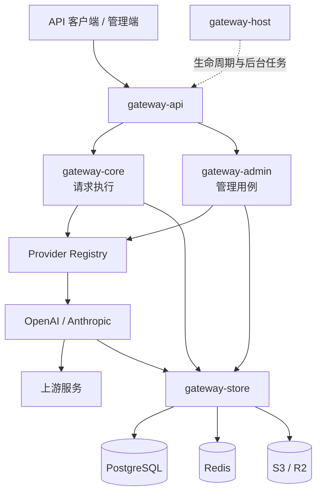
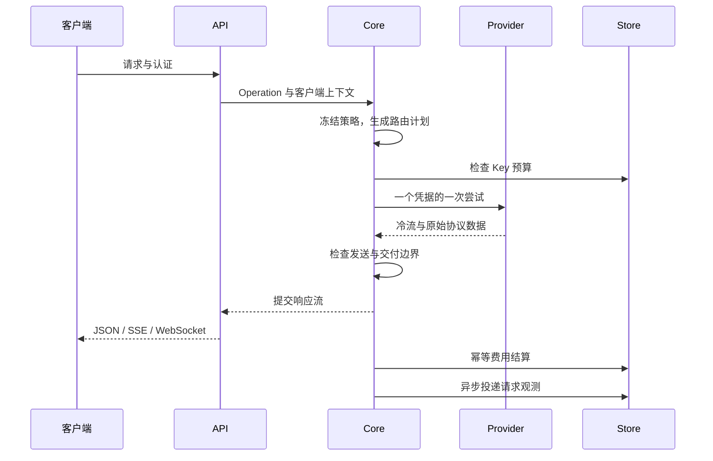

# Codex Proxy RS 架构

本文说明模块职责、请求流程、状态存储和必须保持的约束，主要供修改代码的维护者和 AI agent 核对边界；
第 1–2 节是系统概览，其余章节是按模块组织的实现合同。
具体 HTTP 字段见 [接口文档](api.md)，部署参数见 [部署文档](../deploy/README.md)；上游 URL、超时、
重试间隔和 UI 布局属于源码或配置，不在架构文档重复维护

| 阅读目标 | 章节 |
| --- | --- |
| 了解模块边界 | [运行拓扑](#2-运行拓扑)、[Workspace](#3-workspace-边界)、[前端职责](#33-前端模块职责) |
| 跟踪一次请求 | [请求生命周期](#4-数据面请求生命周期)、[协议边界](#5-provider-与协议边界)、[路由与结算](#6-路由账号范围与-continuation) |
| 修改配置与持久化 | [控制面](#7-控制面与-revision)、[状态所有权](#8-状态所有权) |
| 维护运行行为 | [凭据与额度](#9-credential额度与主动重置)、[观测与任务](#10-观测与后台任务)、[生命周期](#11-生命周期安全与恢复) |

## 1. 系统定位

Codex Proxy RS 是单进程、单副本运行的多 Provider AI 网关，同时提供：

- 面向客户端的 OpenAI Responses、Chat Completions、Images、standalone Search 和模型目录协议
- 面向官方 Claude 客户端的 Anthropic Messages、count_tokens 和原生模型目录，所有有效 Claude 请求经过同进程 veil
- 面向管理员的 `/api/admin/*` 控制面和 Vue 管理端
- 面向 Key 持有者的 `/api/key-usage/*` 用量与客户端配置接口、独立 `/key-usage` 页面，以及复用数据面认证的 `/v1/usage` 额度查询
- 固定的 OpenAI 与 Anthropic 两个编译期 Provider
- PostgreSQL 持久化、Redis 协调状态以及 S3/R2 数据库备份

Chat Completions 通过 API 协议转换复用 Responses 执行链。系统不存在 Provider Instance 层，也不支持
通过复制应用容器进行多副本扩容。Client Key 限定账号分组，而不是绑定某个 Provider；一次请求的
Provider 候选由账号范围、模型能力和运行时健康共同决定

## 2. 运行拓扑



图中表示运行时协作，不是 crate 的直接依赖。`backend/apps/gateway` 是网关的唯一组合根，
按 Host → Store → Provider → Core → Admin → API → Worker 的顺序
初始化具体实现。其余 crate 只暴露自己的配置、端口和 Bundle，不自行定位别的实现

## 3. Workspace 边界

| 路径 | 责任 |
| --- | --- |
| `backend/apps/gateway` | 读取顶层配置、连接 Bundle、注册 Provider 与 Worker |
| `gateway-protocol` | 跨层共享的 OpenAI 与 CPR 互联线协议、SSE 编解码与无业务 owner 的解析事实，不依赖其他 workspace crate |
| `gateway-core` | operation、canonical event、请求快照、路由、admission、attempt 协调、交付边界和计量 |
| `gateway-admin` | 管理领域、Key 用量、互联共享查询与上游同步、Provider/Store 端口、审计语义、备份与历史保留策略 |
| `gateway-api` | HTTP/WS/SSE 解码与交付、Admin 与 Key 用量 wire、静态 Web UI；不直接访问 Store 或具体 Provider |
| `gateway-store` | PostgreSQL、Redis、S3/R2、`pg_dump` 适配器；不拥有业务策略 |
| `gateway-host` | 配置加载、日志、HTTP 生命周期、Worker 监督、Prompt 审查与历史保留任务、系统更新、互联 HTTP 与外部价格源适配 |
| `providers/openai` | OpenAI OAuth、账号选择、目录、额度、Responses/Images/Search transport |
| `providers/anthropic` | Claude OAuth、原生 Messages、账号亲和、目录、订阅窗口与缓存费用观测 |
| `frontend` | Vue 管理端与 Key 用量页，仅通过各自身份允许的控制面 API 访问状态 |
| 独立仓库 `codex-proxy-ui` | 管理端使用的 Vue 基础组件、纯主题算法和样式，不依赖宿主业务状态、路由或 API |

依赖方向遵守四条规则：

1. Core 不依赖 HTTP 服务器／客户端、数据库、Redis 或具体 Provider
2. Provider 之间不互相依赖，也不决定跨 Provider fallback
3. API 只调用 Core/Admin 抽象；Store 只实现端口
4. 具体实现只在组合根相遇

管理变更的审计动作、实体分类与 actor 投影由 Admin 的类型化操作和审计意图定义。
Store 按端口命令与实际提交结果选择操作、补齐稳定实体标识和物理差异，在同一事务写入配置 revision 与审计记录；
适配器不另定义动作和实体分类字符串，也不为生成审计而在事务外重复读取旧值

`frontend/` 独立管理 Node 依赖、锁文件和 ESLint，根目录不建立前端 workspace。
`modules/ui` 是组件库的可选子模块，不加入宿主 Cargo 或 pnpm workspace，也不参与宿主发行构建。
固定依赖、安装许可与源码联调见[开发指南](development.md)；组件和主题的消费边界见[主题架构](theme.md#架构概览)。
Pinia 持久化、登录、路由和业务请求由各应用持有

部署时区由 Host 配置拥有，组合根把不可变的 `DeploymentTimeZone` 传给各模块。
Core 的 `time` 只提供时区与日历边界换算；Admin/Provider 拥有查询范围与调度规则，Store 绑定显式 UTC 边界并维护事务。
API 的时间 presenter 负责部署时区下的日期及事件展示文本，前端不重新解释时区或格式化绝对日期；最近使用的相对时间本地化边界见 [API 页面时间](api.md#页面时间合同)。
持久化、协议传输、排序与 TTL 使用 UTC 时间点或持续时长，不依赖进程、浏览器及数据库会话的本地时区。
请求位置中的时区属于 Provider 请求身份，与部署日历规则独立。配置操作见[部署时区](../deploy/README.md#部署时区)

### 3.1 Rust 模块组织约定

后端采用目录模块的 `mod.rs` 风格；模块边界按以下规则维护：

1. crate root 作为顶层门面，声明模块并暴露该 crate 的配置、Bundle、端口或稳定领域合同；目录节点使用
   `目录/mod.rs`，叶子模块使用 `名称.rs`，不混用 `名称.rs` 与 `名称/` 两套入口
2. 生产源码不使用内联 `mod name { ... }`、`#[path]` 或 `include!` 隐藏文件归属。`lib.rs` 和各级
   `mod.rs` 是模块门面，负责声明子模块、选择性 re-export 与少量同层协调
3. 子模块默认私有；只有真实的跨 crate 生产合同才能使用 `pub`。adapter/provider 的公开根模块由
   allowlist 冻结，变更必须同步完成边界审计，不能为测试或兼容路径创建第二 owner
4. owner 级依赖保持单向。两个模块互相引用时，应把共享值对象、端口或生命周期能力提升到共同 owner，
   不能依靠同一 crate 内可见性掩盖循环边界

较大的模块门面只负责组合和 re-export：账号 Admin HTTP 边界按 `wire`、`credentials`、`handlers`、
`presenter` 划分；Provider 执行按 continuation、stream、failure、observation 和 worker 等职责拆分。各子模块之间只使用 owner 内最小可见性

### 3.2 `gateway-core` 内部 owner

`gateway-core` 内共享事实按语义 owner 划分：

| 模块 | 唯一责任 |
| --- | --- |
| `validation` | 纯值对象校验错误和文本约束，不依赖事件、执行错误或路由 |
| `identity` | Provider 身份值 `ProviderKind`，只依赖纯校验 |
| `account` | Provider 账号/credential/quota 值对象、持久化端口与请求级账号选择；`scope` 持有分组、账号目录和冻结账号范围 |
| `policy` | Client API Key 准入、原始 Key 设置与客户端版本策略；只使用账号范围、Provider 身份和基础校验 |
| `metering` | 标准化 Usage、金额、费用估算与费用明细；不表示账号或开票系统 |
| `upstream` | 跨 Engine、Event、Error 与 Provider 共用的 transport 名称、尝试传输档位、发送状态和不透明上游值 |
| `lifecycle` | 取消信号、可选执行截止与租约生命周期、连接注册与 drain 合同 |
| `engine` | attempt、发送/提交屏障、执行编排、持久化调用时序 |
| `routing` | 冻结路由事实、请求计划、Provider 只读目录合同、运行时快照及请求设置派生 |
| `runtime` | 当前快照的发布、读取、revision 订阅与周期对账任务 |
| `settings` | 设置值及纯编译规则；由 `routing` 快照组合并冻结 |

`event` 通过 `validation` / `upstream` 使用基础值，不依赖承载原始事件的执行错误；账号值对象和
选择策略通过 `identity` / `account::scope` 使用身份与范围，不依赖路由计划。`routing` 和 `error` 的
相关公开类型通过 re-export 引用上述定义，类型所有权和 Core 内部依赖归属定义模块。架构测试约束这些叶子依赖，
并检查一级 owner 的显式 `crate` / `self` / `super` 路径与重导出形成的依赖图；它不替代 Rust 名称解析和行为测试

`routing::request_settings` 统一解析宿主与 Key 默认值、显式覆盖来源及请求快照重算，不向全局发布请求改写。

Provider 模型能力、目录代次与 `ProviderCatalogPort` 由 `routing::catalog` 定义。快照编译和对账只消费
该只读合同，不反向依赖执行注册表；`ProviderRegistry` 实现目录端口，维护唯一的 Provider
注册集合。已知空目录与查询失败的未知目录保持不同语义，目录替身无需实现请求执行。
Provider 可为模型提供来源账号集合；Core 在公开目录查询时结合冻结账号范围与政策过滤来源，
配置发布复用已缓存的来源事实。来源集合只约束目录展示，不直接作为推理账号白名单；Provider 独占上游资格判断

客户端原生模型目录同样由 Provider 拥有，通过 `ExecutionService` 和现有 Registry 的只读调用传递。
`routing::catalog` 的原生条目只包含模型 ID 与不透明协议正文，Core 负责冻结账号范围和整对象模型映射，
不解析上游字段；API 负责协议输出，不直接依赖具体 Provider。原生目录失败不会退回通用画像，只有不提供
该协议原生目录的 Provider才走画像转换。目录读取不创建计量请求或推理 attempt。
OpenAI 的账号/凭据 revision/客户端版本隔离、并发合并、TTL、容量与失效均归属 credential catalog
service；客户端原生对象保存在有界进程缓存中，与套餐 Redis 模型 ID 缓存分开管理。
该缓存最多保留 32 项，原生正文总预算为 32 MiB；单次结果超过预算时仍正常交付，但不驻留缓存

全局请求位置及开关由运行设置持久化；快照仅在开关开启时生成全局覆盖，并随
`RuntimeSnapshot → RoutingPlan → AttemptContext` 冻结传递，关闭时保留客户端原有字段；
Provider 在选定账号后应用代理位置覆盖。请求期间不额外查询全局设置，配置发布不改变已开始请求的全局值

隐私规则合同及编译端口由 Core 定义，OpenAI Provider 拥有路径、正则和承载结构的解释，Admin 的保存校验与样本预览复用同一实现。
Store 将策略与设置 revision 原子持久化；编译结果随快照、计划及 attempt 冻结，未改变策略的请求设置覆盖复用已编译对象。
规则在宿主请求头和 WS metadata 投影完成后作用于本次出站副本，重试及传输回退从原请求重新构造，避免重复替换。
每条规则跨承载副本原子提交；发送前拒绝携带 `NotSent` 和禁止重试标记。被规则改写的握手头参与 WS 池身份，防止复用旧值，
关闭策略不进入改写管线。字段与执行限制见[隐私策略 API](api.md#隐私策略)

Fast 策略由 Core 合并 Client Key 的全部绑定分组并随同一快照链路冻结，禁用分组也参与合并；
不按所选账号的分组重新解释。三态覆盖顺序与字段合同见[账号分组 API](api.md#6-账号分组)。
OpenAI Provider 在独立编码请求上、生成上游头与观测前统一应用顶层档位覆盖，HTTP、WS 与重试共用。
该策略不改变选号、会话亲和或共享原始请求；每个新 WS 请求重新取得当前策略。
WS 路由提示属于握手，连接复用时不重发；档位变化不重建连接或打断 `previous_response_id` 续写，
各帧正文及计费仍使用本次请求的最终档位

生图权限由 Core 随 Client Key 的账号范围冻结，绑定分组中禁止优先，禁用分组仍贡献限制。
执行入口在路由与准入前拒绝生图 operation，attempt 中间件提交最终 operation 时再次校验；
拒绝使用统一 `PolicyDenied`，发送前失败标记为 `NotSent` 且禁止重试，不改写原始工具声明。
识别复用 operation 的生图语义，跨协议翻译保留原始生图事实；普通图片输入不视为生图。
字段、默认值与协议边界见[账号分组 API](api.md#6-账号分组)

`engine::observation` 统一维护单次响应的用量、费用、时间和响应 ID，并负责重试前清理；协调器继续
独占发送、提交、重试和终结顺序。Provider 上报费用优先于本地估算，丢弃的 attempt 不得污染最终计量。
Provider 本地估算按当前 attempt 实际发送的上游模型查价，响应声明的模型只作观测；费用明细复用同一口径。
Client Key 费用账本独立累计各次 attempt 的实际费用，不能因请求重试而清空已产生的费用或未知计费状态

### 3.3 前端模块职责

`frontend/src` 持有应用状态和业务交互，基础组件与主题算法由 `@codex-proxy/ui` 提供，组件目录与合同见 [UI 组件架构](../modules/ui/playground/guide/architecture.md)：

| 入口 | 职责 |
| --- | --- |
| `api/modules/` | 页面 HTTP 合同，模块名对应 `views/` 一级目录；复杂模块在同名目录内按功能拆分，业务类型由所属模块定义 |
| `api/types/` | 跨业务模块共享的接口类型，如时间展示与请求位置；不依赖请求实现或业务模块 |
| `api/request/` | 请求入口与插件链；负责会话恢复、重试、错误提示、错误归一化和原始／流式响应处理，页面不重复解释响应信封 |
| `stores/modules/`、`router/`、`plugins/` | 应用级登录与界面状态、路由和初始化；服务端数据的权威仍在后端 |
| `views/<页面>/index.vue`、`views/<页面>/components/` | 页面组合与局部交互；复杂组件按职责拆成目录入口和相邻模块 |
| `views/<页面>/composables/` | 页面查询、轮询、表单及操作生命周期 |
| `presenter.ts`、页面 `utils/` | 纯展示投影或该页面拥有的业务转换，不启动请求 |
| `components/usage/`、`components/account/` | 跨页面复用的用量、健康时间线、套餐和额度窗口展示 |
| `composables/` | 请求取消与过期结果隔离、分页、选择、异步动作、目录加载等共享机制 |
| `i18n/` | Vue I18n 实例、三语资源和应用语言策略；从全局 Composer 派生 UI 库语言，不翻译用户数据或远端自由文本 |
| `utils/` | 按用途分开的数据解析、数字与时长格式化、位置校验、客户端配置及颜色工具 |

JSON、原始字节与流式请求共用会话恢复和身份代际校验，身份变化后的迟到结果按取消处理。
流式成功正文由消费方持有读取、期限与取消；交付前失败时，请求层终止底层传输

概览的数据请求和刷新由 `useDashboard` 持有，`views/dashboard/presenter.ts` 生成展示模型。
Key 创建与编辑共用 `useApiKeyEditor` 和 `ApiKeyFormModal`，`useApiKeyUse` 持有创建结果与使用操作的明文，
关闭对应弹窗或页面销毁时清除。
用量表格的列、展示投影及健康时间线规则集中在 `components/usage/shared/`，管理页面与 Key 用量页共用展示，
各自的查询仍使用对应身份允许的 API

`useRequestState` 管理取消、请求序号与失效结果；分页按接口合同分别复用 `usePagedQuery` 或 `useStablePagedQuery`。
`useAsyncAction` 的 `loading` 是动作进行状态，调用方直接使用；接口错误由请求层提示，本地操作错误按动作配置处理。
可由草稿与保存快照比较得到的修改状态使用派生值，不另维护同步标志。
展示字段和业务资格沿用后端事实，数字与持续时长可以在前端格式化，日期与时区合同见 [API 页面时间](api.md#页面时间合同)

基础设置由整页统一保存与撤销；切换分区或供应商保留草稿，保存时校验两种供应商的全部基础设置，包括当前隐藏的模型映射。
校验失败切换到对应分区和供应商；明确拒绝或 revision 冲突保留草稿，执行结果未知时回读服务端状态。计价、备份、Claude 入口及 Prompt 审查沿用各自领域的保存边界。
概览页指定供应商时客户端身份卡跟随，查询全部时保留卡内切换；供应商切换取消旧请求并使其序号失效，统计缓存键包含供应商，账号摘要先筛选再限量。
用量页的时间与供应商限定整页，Key、账号、模型与成功状态限定明细；只有筛选范围相同时刷新才保留旧汇总。

## 4. 数据面请求生命周期



请求开始时冻结 `RuntimeSnapshot`、Client Key 的账号范围及账号模型政策、模型映射、Codex 客户端最低版本、Provider
候选顺序和调度策略。
运行中的请求始终使用该快照，不拼接不同版本的配置，也不在热路径查询分组关系

模型请求默认不限制总执行时长，Provider 的传输空闲超时独立生效。
Client Key 并发占用、账号调度槽位与请求恢复记录使用可续期租约，不把租约 TTL 当作总执行预算。
会话结束或 Drop 后停止续期；Redis 并发租约丢失或无法在有效期内续期时取消请求，避免失去并发约束后继续执行

Client Key 鉴权完成后，API adapter 从有界请求头识别客户端，Core 使用请求冻结的 `RuntimeSnapshot`
检查最低版本，在进入 Provider 前完成门禁。请求头优先级、远程客户端识别与错误合同见[鉴权约定](api.md#1-鉴权与公共约定)

核心不变量：

- 一个客户端请求对应一条 `model_requests`；attempt 是请求内事实，不建立第二张权威表
- Provider 的一次 `execute` 只选择一个 credential 并返回一个冷流；换号、重试和 fallback 由 Core 决定
- OpenAI 的自动恢复限于明确识别的账号、容量、`503 + error.code=server_error`、续接和传输场景；
  其他上游拒绝保留响应与重试提示，交由客户端决策。WS opening 尚未发送业务 payload 也不扩大该恢复范围，明确的 `426` 仍允许 HTTP 回退
- `not_sent`、`sent`、`ambiguous` 是单调的上游发送边界；结果不明确时不能假定上游未收到请求
- OpenAI HTTP 与 WS 的瞬时建连失败共享请求级 opening 预算。Provider 显式允许后，Core 仅在整个请求尚未发送且无续接依赖时为替代账号预留机会；
  同账号恢复不消耗换号次数，跨账号选择受路由尝试和换号预算约束，WS 重试或降级 HTTP 仍由 Provider 传输策略决定。
  外部指定账号、禁止重试、输出交付、取消和执行 deadline 继续限制恢复；Claude 不获得新的传输恢复权限
- `upstream::ProxyEndpoint` 是共享的脱敏主机/端口事实，账号代理负责匹配，错误类型不反向依赖账号领域。
  仅确认账号代理 TCP 入口不可达时，Core 在本请求的 `excluded_proxy_endpoints` 中记录并下传选号；共用入口的账号一起跳过。
  TLS 证书、代理认证和 SOCKS/CONNECT 拒绝不扩大排除；排除不持久化且不记录凭据。全池入口已排除时保留原故障结束，
  其余建连失败无替代账号时仍可回原账号消费剩余预算
- downstream commit 记录不可撤回的首次交付；不可重放事件交付后禁止换号、重试和 fallback
  HTTP 保活可先提交响应头，Core 记录该首字节时间与实际状态，但首个业务批次仍独立提交；
  SSE 注释不构成业务输出或上游已发送的证明，也不改变重放资格
  Core 单独维护重放屏障，仅 Provider 明确标记的可替换前导保留重试资格，仍检查错误分类、续接归属、发送状态、副作用及预算
- API 在最终错误编码出口投影客户端恢复信号；该投影不修改 Provider 上游事实，也不改变 Core 的
  重试与提交边界。具体错误合同见 [数据面接口](api.md#3-openai-数据面与模型目录)
- Provider 为有界同账号退避显式选择耗尽动作：允许换号，或返回客户端错误；Core 在既有安全重放边界内执行，按账号维护请求内预算
  该退避消耗总路由预算，与 WS 传输恢复、OAuth 刷新及账号额度冷却分开；具体次数、退避与 `Retry-After` 规则见[容量拒绝与重试](api.md#容量拒绝与重试)
- `RetryThenReturnError` 的终态失败按 Client Key、逻辑线程与轮次写入 Redis，后续同轮次请求命中时跳过该策略的退避重试，直接交回错误；其他恢复策略不受影响
  API 从明确的客户端推理请求提取轮次，Core 不解析协议正文；预热、压缩、内部调用和探测不参与该状态
  标记在失败终态交付前写入并续期；成功终态交付前按请求入场时读取的版本原子清理，迟到成功不能删除较新失败
  Redis 操作使用独立有界等待，读取失败沿用原重试策略，更新失败保留原响应；TTL 到期或状态丢失后重新获得预算，不承诺精确识别客户端重试意图
- OpenAI Provider 与 WS 传输层不暂存前导等待后续事件，正常帧按顺序即时交付；
  Provider 只保留单向推进的重放边界，实际输出、终态或未知事件关闭重放窗口。
  中间件链中的正常事件同样即时交付，但不保留可替换前导的重试资格。
  有效输出交付前的 WS 传输错误可请求有界同账号尽力恢复，即使发送结果不明也保留此恢复意图；
  发送事实与安全重放证明不因此改写。Provider 限定传输次数与续接范围，Core 保持原账号并检查
  取消、deadline、已观测外部副作用及下游交付边界；只有明确未发送、无续接依赖的瞬时建连失败才可预留换号机会
- 换号预算从运行设置冻结到请求计划，选中账号与上一 attempt 不同时计数；首次选号、同账号重试和
  选号阶段过滤候选不消耗预算。跨 Provider 候选推进与 continuation 排除重放同样受限，预算耗尽后
  以最后一个原始上游错误终态；配置与总尝试上限见[账号亲和与换号](api.md#账号亲和与换号)
- Provider 显式标记的终止拒绝禁止自动重试与传输回退，优先于未发送状态和安全重放证明
- 跨 Provider 只在账号范围和能力都允许，且请求尚未到达上游或已被证明可安全重放时发生
- 可恢复观测写入失败不能替换已经确定的客户端协议结果

Responses 按模型目录编译候选；全局模型映射是精确映射，未命中时模型名原样交给候选 Provider。
Chat Completions 由 API 将入站消息规范化为 Responses 正文，进入共用 Generate 执行链；
request 中间件回程经过 Responses 协议复核后，再由 API 投影成 Chat JSON 或 SSE。
HTTP 中间件位于转换外侧，request 与 attempt 中间件处理 Responses，实际 endpoint 始终为 `/v1/chat/completions`。
Chat 复用既有提交、取消与终结生命周期；Core 继续独占路由、重试、交付事实与结算，
Provider 继续独占上游身份、字段兼容、隐私策略及账号隔离，Chat 层只负责协议映射。
转换只拥有协议结构：同语义字段交给 Provider 与上游，无对应语义的可选控制项可降级忽略；
丢失用户输入、客户端动作或无法表达响应的转换须明确失败，不补造结果。
字段合同见 [Chat Completions](api.md#chat-completions-请求)

Images 与 standalone Search 是 OpenAI Provider 自有端点：两者都不参与文本模型映射，只在 Client Key
的账号范围确实包含 Codex 账号时生成单一 OpenAI 候选。Images 的图片模型由 Provider 从正文旁路
提取，用于账号模型政策检查，并在中间件改写后复验当前租约账号；不要求图片模型进入文本目录。
Search 的请求身份与正文透传规则见 [OpenAI 透传](api.md#openai-透传)

WebSocket 的根执行携带不解释协议的连接控制端口，Provider 在请求写入上游后绑定原 socket。
API 在响应期间发送控制帧，终态后还可读取原连接事件；空闲读取必须在下一轮执行前取消，
与 Provider 正文消费共用单一有界接收通道。连接 owner 持有控制目标，复用时替换，销毁时释放；
控制句柄使用弱引用，不延长连接生命周期，也不经过全局响应查询、新选号或独立 attempt。
API 暂存的下一轮请求和连接泵接收队列共用容量名额，控制帧处理不取消中间件正在读取响应体的 future

## 5. Provider 与协议边界

Core 只理解 `Operation`、能力要求、Provider 候选、稳定错误和 canonical event，不读取 Provider SDK
类型。Provider 独占 credential schema、OAuth、账号选择、模型目录、额度投影和上游 transport

Responses 下游连接的心跳和退出由 API 拥有，每条 WS 使用独立取消信号，沿 Core 的 `ResponseControl` 传到 Provider 请求上下文。
单轮执行结束不取消连接生命周期，连接退出则取消当前执行及仍归它所有的上游资源；API 不直接调用具体 Provider 清池。
OpenAI 的连接池监督该取消信号，按当前归属保护绑定连接；精确续接接手 socket 时撤销旧控制收发并转移归属，旧客户端不能消费新响应或清理新 owner 的连接。
重新绑定或切到 HTTP 时移除失去用途的旧连接，失效 reservation 不能重新归池。
普通空闲期限复用池槽位的 `idle_since`，只在归池时重置；心跳不刷新业务空闲，建连与在途不参与空闲回收。
回收先移出可复用集合，再在锁外有界关闭并等待 pump/socket 释放，物理容量随 socket 归还；批量关闭并行执行。
Codex OAuth 上游 WS 在首个请求写入后记录搜索声明，握手完成但尚未发送请求的连接仍未初始化。
后续首次声明搜索时，连接池回收不兼容的原连接；普通新链重新建连，连接内续接交由客户端完整重放。
该判断共用于 HTTP 与 WS 入站，不修改客户端工具声明，也不保留对话正文。
协议合同与运行参数分别见 [Responses 传输](api.md#websocket-与上游传输)和[部署与运维](../deploy/README.md#公网访问)

OpenAI Provider 按 Client Key、所选 OAuth 账号和父响应 ID 关联 WS 握手的路由 Cookie 快照，
只供 Guardian 使用，不参与选号或写入账号凭据。进程内最多保存 4096 个父响应，保留 30 分钟；
缺失或失效时按普通上游路由执行。transport 负责 Cookie 有效期和同 origin、同端点路径约束，
连接池按快照身份隔离审查连接；复用父连接不会重新计算 Cookie 有效期，Cookie 到期不强制关闭已建立的审查连接

OpenAI OAuth 的连接、续接状态、Guardian 路由 Cookie 和头像缓存按本地账号、上游用户与工作区隔离，同号令牌续期不改变归属。
OpenAI Provider 统一处理 Responses 的账号归属与 turn state 隔离，HTTP 与 WS 消费同一出站请求。
全量请求缺少本地归属记录时保留客户端回传的路由 token，明确换号或可信续接状态不属于同一轮时清除；
turn state 不参与选号，也不授权其他账号状态或 response ID 的复用

OpenAI 的 OAuth 与 API Key 共用现有账号和事务。API Key 的 Base URL、密钥和传输策略属于 Provider 凭据 JSON，
随 credential revision 更新；普通详情只投影非敏感连接设置。API Key 客户端目录按账号、凭据版本和客户端版本隔离，
标准 `data` 模型列表通过通用画像输出，完整 Codex `models` 目录保留原生对象。通用账号层按 Provider 提交的
credential state 调度，不以是否存在上游用户 ID 推断可用性；OAuth 未完成身份投影时由 Provider 保持 `unknown`。
状态恢复和未补齐身份的凭据轮换保留 `unknown`。
API Key 默认 HTTP/SSE，可选 WS 优先；选号先验证传输资格，WS pool 与 continuation 按凭据版本隔离。
OAuth 与 API Key 共用业务请求、响应和能力透传链路，差异限定在上游地址、认证、传输配置及明确的上游请求合同适配。
OpenAI 模型目录用于发现与原生 Responses 账号资格筛选，OAuth 按套餐、API Key 按账号与凭据版本匹配目录。
目录与账号白名单的优先级见[路由与账号范围](#6-路由账号范围与-continuation)

- OpenAI 是透明边界。正文兼容、身份归一和显式请求策略之外的业务字段保留原始语义；
  业务响应按原始字节转发，客户端错误兼容与原生续写额度恢复按明确例外处理，见 [OpenAI 透传](api.md#openai-透传)。
  `transport/correlation` 在出站副本上按本次安装身份统一映射关联标识。
  Responses 的账号归属判断及换号头部清理由 Provider 统一执行，各传输消费同一出站请求。
  原生安装身份由 OpenAI Provider 按 Key 种子、Key ID 与选中账号 ID 确定性派生，无需额外映射表；未配置种子时取自账号，与 UA 继承方式无关。模型目录缓存按生效身份隔离，Live 后续阶段使用引导时冻结的种子
  内部选号、亲和、连接池与本地诊断继续读取原始身份；具体字段边界见 [API 协议](api.md#请求头与身份)
  canonical facts 从同一数据旁路提取，用于路由、恢复判断、观测和计费。
  WebSocket transport 按完整文本消息交付，wire 同时保留原文与可选解析视图；同协议出口使用原文，
  SSE 转换只发生在需要该表达的出口。原生封套继续携带原始文本，观测失败不否定交付。
  非流式 Responses 由 API 聚合 wire：终态省略或清空 `output` 时，使用同一响应的 `output_item.done`
  按 `output_index` 还原完整输出；已有非空终态输出不改写。完成项缺失或冲突时在下游提交前拒绝，
  不凭 canonical 增量补造内容，也不让 SSE/WS 转发额外保存整份输出
- Responses、Images 与 standalone Search 的业务扩展头保留原始多值字节。API 负责剥离鉴权、账号身份和 HTTP 传输字段，
  并提取会话语义；`gateway-protocol` 共享 HTTP 传输与网关链路字段分类。客户端兼容规则集中在
  `providers/openai/src/compat/`，与上游缺陷补偿统一管理：`headers.rs` 管理下游环境头和已提取语义的头部别名，
  `request.rs` 管理参数过滤、缺省值及请求形状适配；兼容基准为 Codex Core/Desktop 请求协议。
  `search_history.rs` 处理搜索历史缺少工具声明的临时补偿。
  `compat` 只消费请求正文和协议头，不依赖 Provider 或 transport 的执行实现，不持有身份、会话或连接状态。
  Provider 在 `transport/request.rs` 解码不透明头时组合兼容、身份与 HTTP 规则，
  同时调用不依赖账号的正文兼容规则。非官方客户端及跨客户端历史回填兼容的入口，
  由 Provider 在选定 Codex/OAuth 账号后、HTTP/WS 分流前调用；API Key 上游跳过该入口。
  长期协议适配与临时缺陷补偿按文件区分；临时补偿注明外部依据、适用范围和移除条件，直连验证修复后清理对应规则与合同场景。
  `transport/headers.rs` 负责上游身份保护和官方头组装。
  会话别名只规范化请求头，不清除正文身份字段；未知业务扩展与响应诊断头不受影响，字段见
  [Responses 合同](api.md#3-openai-数据面与模型目录)
- Live 共用 OpenAI 的头部身份、下游环境和传输边界，业务扩展不使用固定白名单。
  引导、sideband 与 hangup 由 Provider 在选定或加载钉住账号后统一处理出站关联标识；
  API 保留原始入站事实，Core 只传递头值字节和通话归属，具体合同见 [Codex Live 语音通话](api.md#codex-live-语音通话)
- Anthropic 是原生 Messages 边界，保留 thinking、签名、历史和原始错误，不做 Responses 转换
- response ID 是不透明 UTF-8 bytes，不假设 UUID、固定长度或跨 Provider 可复用
- OpenAI 用户身份选择由 PostgreSQL 保存，Core 在 `FrozenAccountScope` 中按 Key 整体覆盖通用选择，
  以 Provider-owned 不透明对象沿路由计划传递；执行会话复用首次解析结果，使重试不受发布更新影响。
  各 Provider 唯一负责默认值、校验、版本来源及 UA 生成，Admin 提供管理和生效预览。
  首次初始化只写入内置默认选择；YAML 不定义客户端身份，也不作为数据库初始化或请求解析的来源。
  官方发布资料与用户选择分开：OpenAI 在 Redis 按 Provider、客户端、平台、架构隔离可重建版本缓存，
  Desktop 完整制品元组原子更新。CLI 的 TUI/Exec 入口共用官方 CLI 版本资料，Provider 在一次身份解析中
  生成一致的 UA、入口后缀与配套请求头，后台更新不修改用户选择的运行环境。
  完整自定义 UA 经 Provider 校验后原样传递，配套头统一解析；固定和自定义配置不受后台更新影响。
  OpenAI Provider 按 Key 种子、Key ID 与账号 ID 派生出站安装身份；未配置种子时使用账号身份，不改写账号凭据。
  普通连接按生效身份匹配，精确续写固定原连接与身份；配置合同见 [Key 客户端身份](api.md#key-客户端身份)。
  后台账号和 Desktop 专属操作使用独立官方 Desktop 画像，不接受 Key 覆盖。
  Anthropic 不提供客户端身份覆盖，不回写 `config.yaml`

### Anthropic 与隐私网关

`gateway-api` 的 Anthropic adapter 通过通用 `ExecutionService` 和请求中间件执行原生 Messages，
显式声明能力需求并绑定 Anthropic Provider，不经 Responses 协议转换或跨 Provider 别名回退。
请求中间件、HTTP delivery 和执行守卫由 API 公共模块持有；OpenAI 与 Anthropic 分别拥有错误格式及 wire 解释

Anthropic Provider 保留原生请求结构；中间件最终正文经过 Guard，再由 veil 按协议位置脱敏。
`metadata.user_id`、签名与协议控制字段按不透明合同保留，不猜测重写。
账号亲和由 Client Key ID 和明确的客户端 session ID 构成，缺少 session 时走共享公平调度，
已有绑定忙时使用共享有界等待，失权、停用或冷却时按有效候选重新绑定；指定账号诊断不读写亲和。
仅明确过期的 401 在未提交下游、未恢复过凭据时允许刷新并重试同一账号一次

OAuth 材料、刷新状态与账号 revision 继续由既有控制面事务、刷新租约及 CAS 管理。
授权换码与 RT 刷新使用 Redis pending flow 检查点：更新须持有有效 claim 并匹配 provider、flow、owner，保持原 TTL；
密文使用 veil 持久主密钥的独立 HKDF 域和 AES-256-GCM，provider、flow、owner 作为附加认证数据，token 与 PKCE verifier 不以明文落入 Redis。
刷新检查点以原始 RT 的不可逆指纹绑定领取权。发送结果未知、成功回包无法解析、上游 5xx 或检查点写入无法确认时不重放 code/RT；
Redis 数据丢失、检查点到期或 veil 主密钥变更不承诺恢复，需重新授权。

attempt 中间件运行前先把路由模型写入正文；发送前拒绝修改模型、切换 JSON/SSE 或变更 Thread handle。
Thread 按最终正文复核 fast、advisor、thinking block binding、1h cache 与冻结 beta 的一致性，不自动推断或扩充 beta。
SSE 恢复覆盖搜索结果标题/URL、抓取结果 URL/文本、已知 citation 文本/URL，不修改 thinking、签名、`encrypted_content`、`encrypted_index` 或 base64 文档。
原生 `stop_reason: refusal` 照常交付，同时以 `upstream_refusal` 来源进入 Prompt 审查记录，不混入 cyber_policy 候选、不套用会话锁，也不转换为 ProviderError。
Provider 通过原始 JSON／SSE 观察累计用量和终态，不改写上游错误；已观察到的用量及时进入 Core，
断流和取消由公共执行守卫完成唯一终结。
缓存 TTL 细分及计价依据进入有界 Provider metadata，公共用量及 `CalculatedCost` 不新增数据库字段，
费用为 API 等价估算，订阅窗口另从官方 OAuth usage 取得

`gateway-veil` 复用固定上游提交加本地补丁的 Rust 库，宿主只初始化一个运行时。
Nginx 直接转发到 CPRS `/claude`，不设置预鉴权 Key 回传或内部 veil HTTP 服务。
推理、计数、目录快照、诊断、OAuth、profile、额度及后台采集都经过必需的隐私边界；Claude 派生复审也使用同一运行时。
库负责协议感知替换与严格恢复，CPRS 保留账号、认证注入、连接池、租约与结算职责。
Claude 的 HTTP、request 与 attempt 中间件必须经过原生终端，响应状态、正文帧及事实信封保持原样。
中间件可以在终端之前改写请求，最终正文重新审查和脱敏；不支持响应缓存短路、丢帧、拼帧或二次恢复。
Core 只提供通用来源/帧保真合同，HTTP 层将字节流适配到同一合同，不引入另一套隐私算法。
映射按内部 Key ID 隔离，诊断与复审使用请求级空间；SQLite 不自动淘汰，到容量上限拒绝新增映射。
初始化或存储故障关闭 Claude 数据面，管理端仍可读取状态；其他 Provider 不因 Claude veil 故障被直接关闭。
规则指纹、主密钥与映射卷必须配套恢复，signed history 的客户端连续性仍需真实运行证据。
本地依赖准备与部署边界见 [Claude 部署](../deploy/claude/README.md)

模型目录由后台有界并发采集和管理员显式刷新更新，数据面与路由快照重建只读可信缓存。
目录缓存保留 300 秒硬过期，后台在采集时间超过 120 秒后提前刷新；刷新失败不延长旧快照寿命。
账号导入、OAuth、手工及后台令牌轮换提交后唤醒宿主监督的目录任务，合并通知并沿用采集锁、并发上限和超时；
采集失败由宿主退避重试，不回滚已提交凭据，也不跨 credential revision 复用目录。
账号版本、启用状态及权限在发布前复核；单账号失败不撤掉其他有效账号的贡献，无可信快照则明确不可用。
模型能力和可用性不由内置价格表推导；部分用量照实结算，缺价格保留未定价语义

### veil 映射与隐私边界

映射空间按带固定域前缀的已认证内部 Client Key ID 划分，同一 Key 跨请求、跨上游账号保持稳定，不同 Key 互不可见；
不使用上游账号 ID、access token、提示词或客户端自报身份作为映射键。管理端诊断按本次请求 ID 使用独立空间，
后台控制请求不查找或恢复任何用户的文本映射。映射唯一来源是上游 `SqliteStore`，主密钥由宿主安全配置提供

会话可恢复优先：不调用 `purge()`，没有 TTL/LRU 自动淘汰；达到容量上限时拒绝需要新增映射的请求，不挤掉已有映射。
新映射写入成功后才发送引用它的载荷。规则、主密钥或映射身份方案变化会破坏旧会话恢复，需要新卷与新会话。
单实例 SQLite 不提供多实例一致性，不能让不同映射库随机分流同一用户

| 事件 | 结果 |
| --- | --- |
| 重启且数据库、主密钥、规则、身份方案一致 | 沿用持久映射，就绪检查通过后接流 |
| 待发载荷引用本空间已丢失的映射 | 发送前返回 `veil_mapping_missing`，不借用其他 Key 的映射或猜测原文；客户端普通文本不能仅凭占位符形状认定为引用 |
| JSON／SSE 响应包含查不到的占位符 | 按上游 Veil 语义原样保留该字符串，包括普通文本与工具参数；已有且属于当前 Key 的映射正常恢复，不猜测原文或借用其他 Key 的映射 |
| JSON 响应存储访问或解密失败 | 输出正文前返回 503 受控错误，不交付部分恢复的正文 |
| SSE 存储访问、解密或工具 JSON 解析失败 | 丢弃尚未输出的缓冲，按原生错误结束流，不发送正常 `message_stop`，不重放；已输出内容与实际用量保留 |
| 规则、主密钥或身份方案变化，或从不匹配的快照恢复 | Claude 保持不可用，不以创建空库自动修复 |

业务请求顺序为：认证与调度 → veil 就绪检查 → 中间件最终改写 → Guard 评分与必要的脱敏复审 → veil 脱敏最终正文 →
注入 OAuth → 上游发送 → 观察原始用量 → 中间件返回 → veil 恢复 → 客户端输出。最终正文只脱敏一次，复审是单独处理的派生请求；
合法重试复用同一映射空间，不先恢复成明文再发送。veil 引擎与 SQLite 是同步调用，在有界 blocking 工作中执行，并由工作持有并发许可直到完成。
Claude 在发送前为整个请求预留一份 veil 许可，脱敏、错误正文恢复和流式恢复共用该许可；
取消或超时只停止等待，阻塞任务退出前仍持有许可，避免已发送请求在恢复阶段重新竞争容量。
规则、存储或恢复失败时明确终止请求，不回退原文，也不切换到无 veil 的通道。日志只记录请求 ID、阶段、规则版本、命中数与耗时，不记录原文、恢复明文或映射值

脱敏文本缓存只作用于协议 visitor 已判定的普通文本，不缓存或改写 signed thinking、签名及工具 schema 等不透明字段。
缓存键包含内部 Key 的映射空间与文本 SHA-256；缓存属于不可变运行时 State，不跨规则、密钥或映射库代次复用，也不落盘。
缓存条目预算为全局 16 MiB、每个映射空间 4 MiB、单条 256 KiB，最多 2048 条，按最近使用淘汰；
淘汰只影响加速数据，持久映射仍不自动删除；请求内也以有界缓存复用重复映射，减少重复写入。
暖缓存引用在发送前以只读事务校验归属、类型、存在性及密文完整性，映射丢失或损坏不能靠缓存继续发送。
`anthropic.redaction_details` 仅记录数值：工作线程等待、处理、规则与替换、映射访问和缓存校验耗时（微秒），
文本/扫描字节数、缓存命中/未命中数、映射调用/复用数；字节数不是 token 数，暖缓存仍有 JSON 遍历和哈希成本。

`anthropic.restoration_unresolved` 在还原查找未命中时记录占位符、ULID 和映射空间的 SHA-256，
以及该 ULID 是否出现在本次脱敏结果、与请求中最近 ULID 的字符差异数和唯一最近候选的指纹。
这些事实只辅助区分原映射失效与响应标识变化，不参与恢复或重试，也不记录占位符、正文或映射明文。
请求内诊断最多保留 4096 个不同 ULID，超限明确标记不完整，未命中关系保持未知；未命中不使请求失败，
每次处理取走证据，避免后续流事件重复记录；诊断引用集不作为原样保留或映射访问的判定条件。

原生 JSON 与 SSE 的文本块先声明再输出增量，使用量观测不能触发错误的 canonical 序列校验。
SSE 的正常 `message_stop` 等 Core 完成 EOF 确认、结算和租约释放后才交付；收尾失败只交付失败终态。
本地协议校验错误以及上游 HTTP 5xx/529、SSE 过载没有账号故障证明，不扣账号健康分；明确的账号错误与已发送传输错误沿用原评分合同。

隐私目标是限制发往上游的内容，不是进程隔离：同进程内嵌意味着 CPRS 会接触脱敏前正文与恢复后明文，CPRS、TLS 入口与客户端都在可信边界内。
规则命中不代表任意格式的敏感数据都能被发现。客户端绕开网关的 MCP、工具联网或 WebFetch 等流量不经过 veil，
`CLAUDE_CODE_DISABLE_NONESSENTIAL_TRAFFIC=1` 也不等于全部流量进入网关。可逆替换不能证明与 signed thinking 历史兼容，
不透明块保持原样，其接续兼容以实际协议证据为准

### Prompt 审查

Core 只定义审查端口和取消／deadline 合同，Host 持有本地规则与独立语义节点，Admin／Store 持有配置。
OpenAI 在最终隐私规则改写后审查 HTTP／WebSocket 每次 Generate，Anthropic 在最终原生正文生成后审查 Messages 与 count_tokens。
执行中间件改写内容必须进入同一次审查；Provider 在审查后不再改变用户正文

本地按来源和类别评分，纯信号与观察类别不参与决策；普通命中遵循告警／阻断策略，开启严格终止时，严格规则独立达到阈值后直接终止，不调用外部复审。
可选外部复审使用独立 Chat Completions 或 Moderations 节点及 Key 池，不使用受保护的 OAuth 账号池；Chat Completions 携带来源标记，Moderations 只评估当前用户文本，Claude 复审投影先经 veil 脱敏。
enforce 模式区分有效阻断、覆盖不足和基础设施不可用；observe 记录拟处置但放行，不能绕过 Claude 隐私处理。
拒绝标记 NotSent 且禁止重试，不触发刷新、换号或账号降级。
同一根请求以最终正文和策略指纹复用结论，改写后重判；安全摘要随唯一终结进入共享记录队列，不保存原文。
摘要持久化是 best effort，终态与摘要更新为两条 SQL，缺失摘要不可推断为放行；保留与请求明细一致。

上游内容策略反馈只依据结构化 `code/type`，不从错误文案推断；收到失败即进入反馈，不依赖客户端成功收到终态。
反馈按逻辑请求去重，候选按协议和当前文本指纹合并，重复终态不增加证据或重新建立已解除的锁。
会话锁按 Client Key、协议及会话范围隔离，并锁定当前文本指纹；无会话身份时只限制同一请求重放，无当前用户文本时使用完整请求指纹，不扩大为整个 Key 的锁。observe 不建立新的强制锁。

正常请求的待反馈原文仅在请求内存中保留；拒绝后先脱敏完整当前文本，再裁剪为最多 8192 个字符，成功请求不为学习额外建立映射。
完整、截断、不可用和无当前用户文本分别记录，只有完整证据可以进入学习模型；空文本事件共用待补证候选，重放锁仍按请求隔离。
反馈总等待预算为两秒，其中脱敏最多 500 毫秒；证据不可用仍可记录事件和锁，写入超时只表示持久化未确认，不代表锁未生效。

学习模型只能产生草稿，自由文本理由再次脱敏，管理员审核发布后由同一评分器执行；发布或停用与全局规则代次、审计同事务更新。
风险画像复用根请求观察表，按 Key 和协议统计保留期内最近 30 天事实，不建立第二套评分账本；关闭审查及缺失摘要不算审核通过。
页面的供应商筛选只影响查询，不改变共享策略；关闭审查会停止本地判定和反馈，Claude 的强制 veil 仍独立执行。

管理端 `/prompt-guard` 独立承载策略、规则、记录、Key 画像、会话锁及学习候选；候选生成与人工发布分离，不允许模型直接发布规则。Claude 融入现有账号、模型目录、Key 配置与系统设置。页面复用不改变窄领域命令及 revision CAS 的保存边界。
配置、查询与错误码见 [Prompt 审查接口](api.md#prompt-审查)

### 后台账号导入

Admin 拥有进程内导入任务、管理员归属、条目状态与有界队列，以 `account_import` Daemon 贡献给 Host。
API 只校验任务信封、生成完整输入摘要并投影安全结果，不解释 Provider 文档；每个执行条目复用已有
OpenAI / Anthropic 导入用例。并发槽位由单个 Worker 统一管理，条目状态是进度统计的唯一来源。
停止只跳过待执行输入；Host 关闭时停止接收新任务并在关闭预算内等待已开始条目完成。
完成或跳过即释放原始输入，终态记录有时限和数量上限，不写 PostgreSQL 或 Redis。
前端通过当前管理员的任务列表恢复视图，轮询与任务执行互不拥有生命周期。接口、限额与重启语义见
[后台导入任务](api.md#后台导入任务)

### 账号出站代理

出站代理属于账号配置，由各 Provider 在推理、OAuth 服务端交换/刷新、额度、目录和资料等请求中统一使用。
启用的指定代理不可用时请求失败，不退回直连；未配置或代理被禁用时直连，不继承进程的全局代理环境变量，TLS 仍验证证书。
用户浏览器访问第三方授权页时的出口不受网关设置控制

连接池按出口隔离。修改或启停代理推进配置 revision，使后续请求使用新出口；已执行请求可沿原连接完成。
代理变更不推进 `credential_revision`，不会使进行中的令牌刷新因凭据版本冲突而丢失结果。
OAuth 和目录辅助请求使用账号当前出口，令牌刷新不绕过代理

代理独立保存和测试，通过 `outboundProxyId` 绑定账号；账号保留解析后的 URL 供 Provider 使用。
出口测试结果属于诊断信息，不作为选择、授权或导入绑定的准入条件。
双栈出口并发检测，延迟对应首选可用出口的 HTTP 探测耗时（IPv4 优先），不包含另一地址族失败的等待；
检测仍等待两个地址族完成或超时，以保留双栈可用性结果。两者均失败时，延迟为整体检测耗时。
代理启停由代理记录独立持有；关闭时保留绑定、连接配置和位置规则，账号执行投影改为直连，
不使用该代理的位置覆盖，重新启用后恢复原出口。
连接配置改变时在同一事务内同步关联账号并清除旧测试结果。
删除代理在同一事务中校验版本、解除全部账号绑定并写入审计与配置 revision，账号其余事实及凭据版本保持不变。
关联账号支持单独移除：在原子更新中校验当前代理 ID，只清除账号的代理 ID 和 URL，
保留账号其他设置；提交配置版本与审计后复用快照发布流程，使后续请求使用直连。
代理目录只携带关联数量；账号明细通过独立分页读端口按需查询，
在同一个只读快照中统计并读取有界页面，不在目录中聚合完整账号数组。
文件及 AT/RT 导入在上游凭据交换前取得 PostgreSQL 会话级共享咨询锁，直到凭据提交后释放。
代理修改、删除和测试结果写入通过同一资源的事务级独占锁检查，导入期间直接返回冲突。
导入保护连接数量有界，不占用提交所需的连接池槽位，也不持有空闲事务。
请求取消或进程退出时关闭会话并释放锁。探测器由组合根注入 OpenAI 的 HTTP 客户端构建函数，
复用其自定义 CA 加载与证书校验规则，Host 不依赖具体 Provider 包

导入器在认证交换前解析并校验账号出口。sub2api 的代理引用按完整 URL 登记为共享代理并绑定账号；
其 SOCKS5 配置按远端 DNS 语义转换为 SOCKS5H。账号导入只迁移账号及出口，不迁移下游 Key、余额或历史用量。
代理认证信息仅通过敏感账号导出返回，列表、详情、Debug 和普通审计不得暴露；数据库及备份按凭据保护。
输入字段、协议支持与导入校验见 [账号 API](api.md#5-账号)

### Codex 原生生图与认证

管理端导出的 Codex 配置使用代理 Bearer 密钥，并声明服务端托管账号认证。
客户端据此开放原生生图工具，图片生成和编辑由 Images 路由处理。
这只解决客户端能力识别；模型能力、客户端限制和上游账号的实际生图权限仍分别检查

`X-OpenAI-Actor-Authorization` 是客户端能力标记，不是账号凭据。API 解码和 OpenAI Provider
都过滤该 header，网关继续校验 Client Key，上游认证由服务端账号产生。
客户端配置示例维护在 [部署文档](../deploy/README.md#客户端配置)

客户端到代理与代理到上游的传输选择相互独立。客户端的 `supports_websockets = false`
不禁止 Provider 使用上游 WebSocket。OpenAI Provider 按线程独立维护大包回退与 WS 失败预算，
以终态会话更新提示下游重连；API 负责确认成功写出和入站队列空闲。响应终态前的 Close 1000 仍视为失败，
后续恢复请求成功也不改写原失败请求的结果

### 错误与诊断三层边界

错误信息按用途分成三层，不能用同一个 `message` 同时承担协议、界面和诊断职责：

1. **数据面协议错误**：`/v1/*` 继续遵守 OpenAI/Anthropic wire 合同。可交付原始上游响应时保留其状态、headers、
   content type 和 body；原生续写额度恢复由 Provider 单独投影客户端响应，真实上游事实仍用于诊断和记账。
   本地 fallback 使用数据面稳定机器码与安全英文，不受管理端中文化影响
2. **控制面展示错误**：`/api/admin/*` 由 API 统一 HTTP 状态与数值业务码，由 Admin/API owner 提供安全中文
   文案。extractor rejection、namespace 404 和 method 405 也使用同一 JSON 信封；任意 Store、Serde、
   Provider `Display` 不得直接跨越 HTTP 边界
3. **受控错误详情**：运维错误详情分别保存本地原因链与上游响应，原始字段不翻译、不补造，
   不进入普通 Admin 错误信封、Debug、普通日志或持久化错误摘要。连接测试只展示该接口允许的诊断投影

错误分类负责公共响应、重试和账号处置，原始上游 code 独立保存，不受已知分类白名单限制。
本地异常通过标准 `Error::source` 跨层传播；Core 的不透明来源载体保持底层类型，不依赖数据库或 HTTP 库，
普通格式化不展开来源。Store 统一基础设施不可用的转换，Provider 拥有业务分类

Core 的 `ErrorDetails` 统一投影受控详情，Provider、管理请求和后台操作复用该格式。
原始上游正文与本地原因链分开承载，主原因与附属清理失败合计最多保留 32 个节点、64 KiB 文本，
截断明确标记；显式回滚仍等待资源释放，回滚失败附加到主失败，不替换其分类与原因。
本地续写拒绝和 WS Close 派生分类不写入原始上游 code；关闭码与原因保存在关闭事实中。

请求 URL 等请求方向的敏感上下文在附加来源前移除并标记。错误快照保留来源与错误详情，
协议透传响应和未交付事件仍由当前请求独占。详情计入观测队列的内存预算；
队列满、关闭超时或写入失败仍可能丢失记录，沿用丢弃与写入失败指标，不自动重放不保证幂等的写入

管理请求在 API 出口按 request ID 记录一次内部失败，后台任务由 Host 监督器记录；
OAuth 刷新和准入释放等内部处理后继续运行的失败，由消费失败结果的 owner 记录。
这些操作通过 `OperationalDiagnostics` 复用现有有界观测队列与 `ops_events`，
不创建模型请求，也不把基础设施失败冒充成 Provider 上游响应。
OAuth 响应中的令牌字段和回显的刷新令牌在进入受控详情前脱敏，普通日志不展开正文。

日志由作出处置的边界记录恢复、放弃或终态；仅传播错误的层不重复打印。
传输收包使用 debug 摘要，普通日志使用稳定阶段、分类与 request/attempt 关联，不展开原始正文、
任意上游 code 或关闭原因。受控详情无法写入时不能回退到普通日志打印原文

Core 从执行错误生成一份失败诊断，展示与导出共用其中的分类；事件摘要截断时保留有界的失败诊断，
并显式标记截断。完整上游错误归运维错误记录；Admin 按故障目标与关联请求收集已存证据，
API 在认证后的下载边界统一移除凭据并生成诊断文件，Vue 只发起下载。
采集使用共享截止时间和记录上限，部分读取失败保留已有证据并报告缺口；当前环境与事发配置分别标记

Provider 管理适配在仍持有结构化失败事实时选择静态 `public_message`；Admin 将其转为可安全展示的
`AdminError.message`，API 保留其中的 502／503 具体原因，无公开消息时才使用通用回退。认证与未知
内部异常仍保持固定文案，不能把任意 Provider／Store 的 message 直接放行。
管理提示与 Worker 的处置分类是不同职责：例如 OpenAI 刷新已收到 401 时，可以提示已解析的令牌
拒绝原因，但不因此改变现有有界恢复退避和账号终态判定。刷新繁忙、已知上游失败与结果未知分别映射为
409、50201、50202；结果未知不能触发自动重放一次性凭据，Vue 也不重新解析上游错误码或正文

连接测试的 `gateway` / `provider` / `upstream` 来源以及 `not_sent` / `sent` / `ambiguous` 发送状态由 Core 在
仍持有完整执行错误时一次判定；Vue 只能根据稳定字段生成摘要，不能匹配英文错误句子反推来源

Vue 普通管理请求的错误提示由 `api/request/` 请求封装统一负责：优先展示安全信封的 `message`，
缺失或空白时才使用请求层的 HTTP、网络或超时兜底；成功业务码为 `200`，HTTP 成功但业务码失败也会拒绝。
规范化异常保留 `status`、`code`、`requestId` 与 `kind`。页面和 `useAsyncAction` 不重复弹出接口错误；
查询可以保留失败状态与重试入口，本地校验、文件操作、SSE 诊断和成功响应中的业务结果仍归各自 owner

取消或已被新查询取代的请求不弹提示；后台轮询、重启探测等显式使用 `silent`，它只关闭提示，
不吞异常，也不跳过会话失效处理。
批量操作的部分成功汇总、不可逆操作的结果未知等必要业务处理先将对应请求静默，再由业务 owner 提供
一次有上下文的反馈；不得为普通失败重新维护一套消息或业务码映射

### 登录与查询身份

管理员和密钥登录共用 `/api/auth/*`、AuthService、Redis 会话结构和 `cpr_session` Cookie。
登录类型只选择凭据校验方式，权限来自服务端保存的身份。管理入口只接受管理员身份或部署级管理 API Key；
AuthService 每次恢复 Key 会话时重新检查 Key 是否存在且启用；Key 会话不能访问管理员页面和管理接口。
前端只维护一份 Auth Store，不在每个 API 请求上标记身份；401 会话失效、403 权限不足和 503 依赖故障分别处理。
成功登录替换当前浏览器的旧会话，登出必须确认服务端撤销。
管理员访问凭据和续期凭据绑定同一逻辑会话，AuthService 负责签发、身份校验、轮换、不活动期限和最长有效期。
Store 保存凭据摘要与上一代重试所需的派生盐，原子比较后替换记录或撤销；Redis TTL 对齐续期期限，
访问到期不删除逻辑会话，刷新不能重建已退出或过期的键。短窗口重试返回同一代凭据，避免响应丢失与并发刷新互相撤销。
API 把管理员签发结果投影为访问与续期两种 HttpOnly Cookie；Key 会话仅使用访问 Cookie，保持固定期限。
前端首次进入受保护页面先读取状态，未认证时尝试续期；点击、滚动、聚焦等页面活动不单独触发续期；
认证 Cookie 写入在支持 Web Locks 的环境中跨标签页串行，其他环境在当前页面串行。
请求层仅在业务接口返回 `40101` 时共用一次会话续期，失败请求及恢复期间的新请求等待同一结果；
成功后原请求最多重放一次，取消或身份已切换的请求不重放，确认失效才退出。恢复接口跳过该协调以避免循环等待。
读取请求和明确幂等的续期请求遇到临时网络或服务故障时有限重试，写操作不默认执行此类重试。
首次恢复由路由守卫等待校验后放行；临时故障阻止导航，恢复联网或重新聚焦时再次校验，不增加恢复页面。
已有页面遇到临时故障不清除身份
管理员会话保存由已加盐密码哈希派生的指纹，每次恢复时与 PostgreSQL 当前密码核对；普通设置变更不影响该绑定。
改密在 AuthService 验证当前密码和新密码策略，Store 以旧哈希条件更新密码并在同一 PostgreSQL 事务记录审计。
事务提交后旧管理员会话的指纹失配，不依赖 Redis 批量删除完成撤销；原始密码及密码哈希不进入 Redis。
KeyUsageService 从 AuthService 的服务端身份或 Core 的入口认证结果确定唯一查询范围，复用 ClientKeyStore 的额度账本投影和
ObservabilityStore 的范围查询；数据面额度查询不执行推理准入或开启窗口，入口认证和适用的请求中间件仍会执行。
API 只输出各入口所需的字段白名单，不复用管理员的宽响应。
客户端配置通过 ClientKeyStore 显式读取当前会话绑定 Key 的明文，不进入用量响应。
前端 `/key-usage` 独立于管理布局，不挂载管理员菜单或请求管理接口；配置弹窗、Codex 配置及 CC Switch
导入链接生成逻辑与管理端共用，明文仅在打开弹窗时获取，关闭后清除，不持久化到浏览器

## 6. 路由、账号范围与 continuation

Client Key 与账号分组形成授权范围：

- 普通 Client Key 没有分组关联表示 `AllAccounts`
- 有关联时只允许已启用分组成员的并集
- 已绑定分组为空或全部禁用时得到空池，绝不回退为全部账号
- 分组可以包含多个 Provider，账号也可以属于多个分组

开启 CPR 互联共享的 Key 必须显式绑定分组，并且实际推理范围只包含 Provider 确认的直连认证账号。
Core 将直连认证类型与分组权限一起冻结；删除最后一个分组得到空池，当前凭据类型变化也不能绕过旧快照的直连限制。
OpenAI 声明 OAuth 账号为直连；Anthropic 账号不参与互联共享，未声明的 Provider 默认不获得共享资格；互联 API Key 账号不向下一层转供

Core 按映射后的模型冻结 Provider 归属：已知模型只在明确声明该模型且能力匹配的 Provider 中路由，
再应用账号授权、模型政策和请求约束；账号不可用或所属 Provider 被排除不能扩大归属范围。
同名模型的多个所属 Provider 保持标识顺序，重试仍受发送与重放安全边界约束。
未被任何目录识别的模型只有一个 Provider 透传候选时才交由上游验证，多个未知候选不按名称顺序猜选平台。

账号选择综合启停状态、credential/quota 事实、Redis cooldown、并发上限、权重和会话亲和。
默认账号并发上限为 `0` 时表示无限；账号独立正数上限仍优先，未设置则继承默认值。
无限并发只跳过并发上限判断，保留在途租约计数及其他准入约束；含无限账号的容量不投影有限占用比例。
`account::AccountModelAccess` 拥有管理员模型政策的校验与精确匹配语义，存入账号行的 `model_access_json`，
由 `RuntimeAccountDirectory` / `FrozenAccountScope` 随配置快照冻结。Provider 在额度、亲和与租约之前
按映射后的上游模型筛选账号；重试和 fallback 使用同一冻结政策。上游目录和凭据不承载或改写该政策。
客户端目录的政策过滤判断范围内整个候选池，原生模型对象仍由 Provider 独占解释

OpenAI Provider 的账号资格模块统一解释请求类型、认证与套餐限制，Images 和 Live 共用 OAuth 套餐检查。
资格检查复用账号持久事实，在获取租约前与冻结的模型黑白名单共同过滤候选；亲和与重试沿用同一检查

原生 Responses 在评分、亲和和租约前检查冻结的账号模型政策。OpenAI 账号白名单精确命中目标 ID 时允许上游验证，
其余 OpenAI 账号按有效目录排除未列出的模型。OAuth 按已知套餐匹配，API Key 按账号与凭据版本匹配。
OpenAI 使用未满 30 分钟的进程目录快照，选号不请求上游目录。
未知套餐、缺失或过期目录保留上游验证，不从其他账号或套餐借用目录资格

原生 OpenAI Responses 按[官方 Codex 0.166.0](https://github.com/openai/codex/blob/6ff1e1ca3b30fc8b914720681fcf5fe62e95f856/codex-rs/codex-api/src/error.rs#L73)的结构化 `model_not_found` 错误码与状态合同识别模型拒绝，
不从消息或任意正文推断模型权限；通过既有模型级冷却端口记录账号、凭据版本与上游模型，30 分钟内不再选用该组合。
该反馈不冻结整个账号，不改写管理员模型政策，也不占用 WS 传输恢复预算；重试仍遵守交付边界与原生续写固定账号约束。
管理员诊断旁路目录资格与模型拒绝冷却，OpenAI 的受管上游适配器不继承这两项原生限制

账号编辑在一个事务中更新调度事实，批量更新只应用显式提供的字段。导入与首次 OAuth 可携带统一账号设置，由 Admin 传递给 Store，
与凭据在同一事务中提交；Provider 仍独占凭据解析。未附带设置的导入、重新授权和后台刷新保留已有分组、
权重、并发与模型政策。模型政策变更推进配置 revision，不推进 credential revision。管理端导入和账号编辑共用设置表单，凭据输入独立于设置

### 智能调度

Core 定义、校验并统一拥有评分规则，内置选号与诊断复用同一函数；Store 随运行设置和配置 revision 原子保存，
快照编译器将其纳入 `AccountSelectionPolicy`。近似最优容差随立即选号的五项系数总和缩放

- 额度重置使用 Provider 的有效重置时间，未知或已过期时间不加分
- 排队系数只在选择等待队列时结合其他评分和进程内实时等待人数，不影响立即选号分数与容差；系数为零时选最短队列。
  `ConcurrencyWaitQueue` 在同一锁内读取队长并入队，保持已有位置、同级 FIFO、取消回收、容量和共享等待预算；Provider 传入候选须已限定续写范围
- 健康分按已发送尝试的结果计算账号级平滑失败率并随时间衰减；明确容量拒绝的平滑权重为 0.4，其他可计分失败和成功为 0.2
- CPR 互联的观测只进入现有额度分：当前连接 Key 的新鲜预算耗尽，或请求模型完整覆盖的账号池明确耗尽时降低分数。
  单个账号的原生窗口可提供剩余比例，多账号窗口不合并成池百分比；未知、过期和覆盖不完整的观测保持中性。
  数据面只读 Provider 的本地缓存，不触发远端查询，不修改真实冷却、权重、并发、亲和或账号可用状态

字段、默认值与可配置范围见[智能调度设置](api.md#智能调度)

### 原生续接与会话亲和

Continuation 受原请求的 Client Key、账号范围、Provider 和发送/交付边界约束：

- native continuation 固定创建它的 Provider 与账号
- OpenAI Provider 的 OAuth 大包传输预检在发送前执行，新链可选择 HTTP；大 connection-local
  续接和 HTTP `store=false` 后不可原生续写的 WS 增量返回 `ClientReplayRequired`，由客户端重发
  完整历史。体积测量复用 WS 编码结构，Provider session state 仍只携带元数据，不保存 transcript
- OpenAI 在有效输出交付前收到可安全重放的明确额度拒绝时，先隔离账号，再投影 `ClientReplayRequired`；
  丢弃未交付的原错误帧，由客户端提交完整历史开启新链，不把原增量输入交给其他账号。
  真实错误分类、状态码、发送状态和上游诊断保持不变，客户端合同见 [Responses API](api.md#3-openai-数据面与模型目录)
- 原生续接容量拒绝在 Provider 证明安全、无语义输出、发送状态明确、等待建议超限且换号预算允许时，进入 `RotateForClientReplay`。
  该状态只选号并原子准入真实会话绑定；Provider 在 `execute_selected_generate` 前释放选号租约并返回 `previous_response_not_found`，
  不把旧 `previous_response_id` 或增量输入发给替代账号。优先亲和强制更新主绑定，严格后代仍只跟随根绑定。
  CAS 冲突释放租约后重新读取状态；无真实会话、宽松亲和、无替代账号或预算耗尽保留原容量失败，取消、超时与存储错误不能报告迁移成功。
  Core 仅替换客户端错误投影并清除未交付失败帧，保留原账号、错误分类、发送事实、上游请求 ID 和计量，不创建额外生成或 Token 费用
- OpenAI 按 native → replay owner → replay any 推进，并保留官方 `previous_response_id` 语义；
  已知为 connection-local 的原生续接进入重放阶段时，在选号前返回 `ClientReplayRequired`，不认领或迁移会话绑定。
  正常 native 续接仍由连接池核对原连接及 response ID 是否可用
- scope 外账号与跨 Key 复用均拒绝；发送结果不明时，仅接受 Provider 明确给出的有界传输恢复意图

OpenAI Provider 解释官方逻辑 `session_id` 与 `thread_id`，按 Client Key 隔离账号绑定，
账号亲和模式随请求策略冻结：

- 宽松：会话内请求直接按调度策略选号，不使用主账号偏好，成功准入后更新当前账号
- 优先模式在首次成功准入时认领主账号，短时容量或单模型限制触发临时分流
  后备选择使用会话派生的稳定游标，继续受权重、评分、资格和容量约束
  账号删除、停用或凭据明确失效时，Provider 读取主账号当前事实并在后备准入时 CAS 迁移绑定
  耗尽额度的恢复窗口复用账号排队时限，重置时间未知或距离当前时刻超过该窗口时迁移，刚过 reset 的额度复核享有同长度宽限
  原生续接使用实际状态 owner，固定归属的请求只续期既有主绑定；`RotateForClientReplay` 的原子准入必须迁移到替代账号，不沿用普通临时分流的保留规则
- 严格：根线程及后代共享当前账号；绑定缺失时任意会话请求均可按调度策略首次认领，
  已有绑定的后代只跟随当前账号，账号不可用时排队，根迁移后重读共享绑定。
  后代等待超时时，只有账号在当前授权范围内且冻结模型政策明确拒绝时提示模型权限受限；其他资格缺失使用一般不可用文案，错误码保持 `concurrency_queue_timeout`

可关联的 Search、Images、Live 创建请求共用会话绑定，宽松和优先模式不依赖线程身份分流；严格模式下后代请求保留跟随约束。
需要选号时统一使用配置的调度策略；native continuation 受独立的状态 owner 与安全重放边界约束

OpenAI 固定归属请求直接读取目标账号，其余请求按冻结的账号 ID 范围查询 Store
原生会话的完整候选投影由 Provider 短时持有，按 Client Key、冻结范围、模型、调度策略、传输和容量池隔离
投影从读取开始保留 200ms，最多 32 项且合计 8,192 个候选，同范围读取合并，不同范围独立
健康绑定每次重读目标账号及其冷却、运行状态和凭据，容量观测复用完整投影，最终准入由原子租约裁决
目标失效、租约争用或凭据版本冲突触发完整刷新，原生 Provider 使用完整候选评估

Store 只保存带版本的绑定事实，Provider 在取得租约后、发送前原子认领、续期或按模式迁移；快照冲突释放租约并重新选择。
首次认领不依赖根线程先发请求，独立后台任务也使用自身会话绑定。
无显式会话的 OpenAI 生成请求可按客户端缓存键或对话开头形成账号亲和，复用所选模式的准入、等待、迁移与过期机制。
亲和键按 Client Key 隔离，与会话键使用不同命名空间，不建立轮次关联或原生续接归属。
内容亲和存储不可用时，优先模式按普通调度继续选号，严格模式停止发送。
响应完成不写回账号，迁移前已准入的请求可以完成，不能把绑定改回旧账号。显式会话的绑定存储不可用时不绕过绑定发送

官方独立 Images 仅携带 `turn_id`，通过已观测 Responses 轮次关联到会话，关联同时保留根线程或后代线程的调度权限。
轮次关联保存不透明会话键，不复制账号；显式会话身份只用于校验轮次归属。
绑定和轮次关联按同一请求策略中的可配置时长保留，均按 Client Key 隔离。
受管上游适配器收到 OpenAI 协议请求时，按进入 attempt 中间件前的会话事实选号，并在成功准入后记录轮次关联。
其他输入协议不推测 OpenAI 会话身份。

### 并发等待

Core 的 `concurrency` 拥有中立的有界等待位置、优先级与同级 FIFO 唤醒，不依赖账号、路由或执行会话；
账号策略仅引用其中的等待配置值。执行准入与各 Provider 选择器分别持有等待队列，按 Key/账号隔离。
运行并发仍由 Redis 原子准入与账号租约裁决，等待队列只保存当前进程中的等待位置，不复制运行计数，
也不持久化正文或在重启后重放请求。每个等待 owner 最多容纳 1,024 个等待者作为资源兜底

账号并发明细由 Redis 租约关联的最小入口事实投影，不读取请求历史。事实与租约原子创建，按 fencing 校验续期和释放；管理端只对普通池做有界分页读取

Store 监督本进程普通池与审批池的账号租约释放任务，停机时拒绝新申请、取消持有请求并停止续期，在 2 秒预算内完成已发出申请的登记及租约释放，不等待模型生成结束，也不清理其他实例的租约。异常退出或清理失败时仍由 TTL 回收

新请求不能越过同级或更高优先级的等待者，取消或完成等待通过 Drop 回收位置并立即唤醒后继
队首每 100ms 重查容量，需要复核会话绑定或跨账号容量的非队首每 500ms 重查，其余非队首等待晋升通知
OpenAI 内置调度仅在排队目标与固定归属或严格会话绑定一致时，单独重读该账号的资格、容量、目录和冷却
绑定迁移、资格变化或发现空位后恢复完整候选评估，可跨账号调度的等待者按重查周期评估整个候选池
完整容量观测和发送前准入发生在展开之后，等待重查保持在同一次未发送准备阶段，不增加 attempt

Key 的 RPM 在成功准入时才计数，金额限制在入队前及成功准入后检查。
普通账号容量等待只包含并发；严格亲和下的后代线程还可等待根线程恢复或迁移绑定，但等待不使权限、额度或冷却检查失效。
密钥准入与账号选择各自从首次入队开始计时，账号重选、Provider 切换和后续重试共享账号等待预算，两层均受请求总期限约束。
账号队满或超时释放队位后，可按设置对允许换号的请求再选一次可立即准入的账号。各 Provider 仍检查原有资格、租约和会话归属；OpenAI 严格亲和在取得租约后以当前绑定版本提交迁移。
队列满/超时属于本地容量拒绝，不作为上游限流反馈或 Provider 故障熔断证据

#### Guardian 独立并发

Guardian 独立额度由运行设置持久化并随调度快照冻结，每个请求沿用开始时的设置。
Core 拥有容量池、上限与等待合同，OpenAI Provider 负责识别请求类型并选择普通池或审批池。

- OpenAI Provider 在选号前通过统一协议解析识别 `guardian`；原生发送使用同一分类。
  请求头形成的协议上下文与正文 metadata 沿用编码器的既有优先顺序；其他协议不得仅凭同名字段使用审批池。
  会话亲和沿用上述选号合同，适配器不继承原生续接或 WebSocket 约束；选号后的 attempt 中间件不追溯改变已取得的租约。
- `openaiGuardianReservedConcurrency = R > 0` 时，普通池使用账号原上限，审批池使用独立上限 R。
  选号信号、负载评分、策略投影、请求容量观测和原子租约使用同一池的计数与上限，数值边界见 [运行设置 API](api.md#8-运行设置)
- Store 按账号和容量池隔离租约，复用续期、取消与释放生命周期，不复制总计数。
  管理端普通容量的观测只计普通池
- 两个池分别持有等待队列，任一池的队首不会阻塞另一池。审批等待者保持 FIFO，
  可越过单账号等待数量上限，但仍受自身队列的总等待容量、共享等待预算与截止时刻约束；取消及超时必须释放等待位置
- 配置为 0 时审批请求使用普通池；账号排队关闭时不引入隐式队列。Key 层准入仍按原有限额与排队规则执行

等待者重新选号及取得租约前复核所属池的当前队首，不凭已有 ticket 跳过等待顺序

### Client Key 限额与结算

日金额、七天金额、并发和 RPM 按 Client Key 跨账号、跨 Provider 合计，零表示不限；修改限额不重置已用金额。
Core 负责准入与结算时序，Store 持久化费用账本，Admin 负责限额配置。
Admin 的手动重置复用同一账本与 Key 行锁，在一个事务中清零所选周期金额、推进计费起点并写入审计，
关闭所选窗口并保留费用事件，不推进配置 revision，下次使用时重新开启窗口。
结算仍按完成时间判断归属，重置前完成的费用不会重新扣入已重置周期或开启窗口。

- 原生日窗口按部署时区自然日划分；原生七天窗口从首次准入当天日界开始，按七个本地日历日续期，不固定为周一。
  已打开窗口不随时区切换清零或改写 UTC 边界，续接起点不得早于旧终点与人工重置边界
- 金额优先使用 Provider 上报的 USD，否则按现有模型价格估算；订阅账号的估算费用不代表上游订阅账单。
  费用归属请求完成时间，跨日请求计入完成日，延迟写入仍保留原完成时间
- 准入检查已落库金额与当前进程已接管的待结算费用，不预占未来费用。达到任一金额阈值后拒绝新请求，已准入请求仍可完成并使总额超过阈值
- SSE 持有并发名额直到终态；WebSocket 每个 `response.create` 独立准入，空闲连接不占名额。
  Core 在每次请求开始时重新鉴权并冻结当前策略，既有连接也应用已发布的限额与授权范围变更。
  换号和内部重试复用同一名额，Key 与账号并发上限同时生效；预算拒绝或启动失败释放名额

完成、失败、取消和断连使用同一结算路径，在结束时以网关请求 ID 幂等登记已取得费用。
执行会话持有费用登记与准入释放的同一个清理 future；协议等待被取消后，后续驱动或宿主 detached finalizer
继续原清理。Store 接管精确费用后立即返回，响应交付及并发释放不等待 PostgreSQL 落库；
只有执行终态、费用登记与释放均已返回，协议层才可视为 finalized 并放弃清理责任。
缺少用量或价格、无法取得 USD 费用的尝试按零累计，不创建待核账记录，也不会阻断 Key；
内部重试中已经取得的费用仍须累计。发送状态只决定重放是否安全，不能据此推断费用。
请求日志继续保留真实错误、用量与费用来源，账本按零累计不表示上游实际免费

受监督的费用 writer 按 Key 合并小批次事务，负责后台落库、退避重试及关闭时有界排空，
写入取消或结果未知时保留费用并按请求 ID 重试。
写入失败后缩小对应 Key 的批次，快速写入恢复后逐步还原批量，避免慢库反复重试无法完成的大批次。
普通准入通过同一数据库快照读取预算窗口与已落库请求，合并待结算费用并避免重复计算，不执行补账或等待结算行锁；
仅首次使用或窗口到期时开启窗口，仍与重置和结算使用相同锁序。预算准入总等待上限为一秒。
待结算费用达到 4096 笔后拒绝新准入，已准入请求的费用继续接收；缓存上限因此还包含在途请求的收尾费用。
进程退出后无法恢复的费用不会形成欠账。PostgreSQL 不可用或费用队列不可用时拒绝新的计费请求，Redis 继续管理并发/RPM 租约。
预算窗口与费用事件按请求准入时的 Key ID 保存，独立于凭据和请求观测日志。删除 Key 后，在途结算锁定已开启的预算窗口，沿用请求 ID 去重。
日志清理不重置金额，已有日志不会回填为账本费用。
字段与错误合同见 [Client Key API](api.md#7-client-key)

### 用量维护服务

Admin 定义明细扫描、完整分组统计、用量维护与纯计价合同，Provider 复用原生 Token 计价公式。

明细直接维护 `model_requests` 的终态记录，通过统计失效触发器更新投影；计价快照在维护后清空，Key 结算账本保持独立。聚合贡献使用 `request_analytics_1h` 的 `usage_contribution` 集合保存调用方输入，其他集合为请求投影。桶重建和版本重建保留贡献集合，查询在同一快照中按指定维度和归属时间合并贡献；聚合的删除由调用方管理

Store 在单次事务内完成有限批量读写和普通审计，复用观测连接与执行预算。原生统计结果遵守各自数值类型，越界返回错误，不自动修正输入数据。

完整读取在同一只读快照中持有数据库游标，Store 按需交付有界批次，预算覆盖 SQL 和消费等待。
分组统计复用互斥汇总桶与边界窄事实，路由分组使用请求时保存的分组 ID，总计独立去重。

### 模型价格与费用快照

Provider 是内置价目、服务档位、模态和工具费规则的唯一 owner；Core metering 定义中立价格覆盖与
精确金额运算。Admin 管理人工覆盖与手动同步，Host `pricing` 适配固定的 models.dev HTTPS 来源，
由组合根注入 Admin 的 `PricingSource` 端口；Store 负责来源层、人工层与审计的事务持久化。
同步不能覆盖人工项，更新仅修改选中的模型。HTTP 合同与价格边界见 [模型定价 API](api.md#模型定价)

编译 RuntimeSnapshot 时合并同步与人工配置，Provider 缺省项仍由其内置表解释。不可变价格集合经
Arc 随 RoutingPlan 冻结并进入所有 attempt，不在推理请求中读取数据库、Redis 或外部价目，也不复制
整份价目。Provider 按实际发送模型选择配置；自定义倍率只作用于本地计算费用，上游报告金额不变

本地计算费用携带当次拆分、有效单价和倍率，终态观测将其写入版本化费用快照。查询优先还原快照，
不使用新配置解释历史；无快照的旧记录保留总额核对后补充拆分的路径。Client Key 账本使用同一费用
结果沿既有幂等结算流程累计，不依赖请求明细写入成功

## 7. 控制面与 revision

管理写入遵循统一流程：

```text
HTTP validation
  -> Admin use case
  -> Provider prepare/verify when needed
  -> PostgreSQL transaction + audit
  -> invalidate affected Provider-derived facts when needed
  -> publish committed runtime snapshot
  -> best-effort observations when needed
```

会改变路由快照或安全配置的 mutation 在同一 PostgreSQL 事务中提交业务事实、推进内部
`config_revision` 并写入脱敏审计。账号、分组等响应中的 `configRevision` 表示已提交配置，
不构成所有写入的统一前置条件。运行设置整体替换必须携带读取版本，Store 在同一事务比较后才提交，
防止覆盖并发修改；代理等资源使用各自的 `revision` / `expectedRevision`，不能与全局版本混用

账号组的展示投影与配置提交结果分离；提交后的展示查询失败不阻止已提交版本发布，响应可不附带展示记录

人工备份创建与删除不推进配置 revision，Store 在同一事务提交任务状态与审计，Worker 只接手已提交任务

运行设置的共同管理值由 Admin 定义，读取结果与替换命令显式组合这些值，各自持有版本和 Provider 画像的读写语义。
Core 只持有请求所需设置与策略约束；Store 负责 SQL 解码、密钥隔离和事务，API 负责 wire 类型与展示。
HTTP 字段合同独立于宿主内部组合

额度、cooldown、目录 generation、请求统计和自动 credential refresh 属于运行时观测，不推进全局
revision；credential 轮换只推进账号自己的 `credential_revision`。Redis 通知用于缩短收敛延迟，
PostgreSQL 周期对账才是正确性基础

同一 publisher 的管理提交、订阅通知与周期对账共享编译到发布/暂停的临界区，避免旧结果覆盖新授权或
晚到的失败暂停新快照；请求读取不等待刷新锁。对账仍允许持久 revision 回退，不能只比较版本大小。
配置不可确认时暂停新请求；仅目录 generation 变化且编译失败时继续使用旧快照，留待下次对账。
同一扩展集合内，单个 Provider 目录读取失败保留上次成功的模型、能力和来源账号事实，
新账号授权仍按当前配置发布，后续目录 generation 变化或刷新成功后更新模型事实。
成功返回空目录表示模型撤回，移除 Provider 或切换扩展集合时不复用旧归属

## 8. 状态所有权

| 状态 | 唯一权威 | 说明 |
| --- | --- | --- |
| 账号、credential、分组、Client Key、设置、审计、请求与备份记录 | PostgreSQL | 业务持久化事实 |
| Client Key 金额窗口与费用事件 | PostgreSQL | 日历／显式窗口共用准入与结算账本，窗口版本及最近操作参数随窗口原子提交，独立于请求观测与日志保留策略 |
| CPR 互联共享权限与上游观测 | PostgreSQL | 权限随 Key 保存，当前快照复用账号额度字段，刷新排程属于运行期；原始观测时间与本地查询时间分别解释 |
| admission、lease、cooldown、circuit、会话亲和、continuation、失败轮次、OAuth pending、目录 cache | Redis | 可重建、可过期的协调状态 |
| 控制面统一登录会话与登录限流桶 | Redis | AuthService 唯一拥有；保存 Admin / Key 身份、绑定 ID、绝对有效期和计数，不保存原始凭据 |
| 日志、OAuth 恢复记录、在线更新状态、备份暂存 | `.runtime/` | 部署节点本地运行文件 |
| 重置卡库存与消费结果 | 对应 Provider 的上游 | 本地到期计划不能证明卡片仍可用；手动查询直连上游，自动消费前重新核对 |
| 重置卡自动使用配置、发现时间与未决幂等键 | PostgreSQL 账号记录 | Admin 拥有计划与重试编排；账号删除时一并清理，重启沿用已保存时间及幂等键 |
| Provider 公开模型与官方发布资料 | Provider/runtime cache | 由官方目录或发布源刷新，与 PostgreSQL 中的用户身份选择分别管理 |
| Windows 安装包临时直链 | Host 进程内短缓存 | 按需解析、严格校验、到期前丢弃；不写 PostgreSQL/Redis，也不代理包字节 |

账号对外状态不是独立列，而是 PostgreSQL credential/quota 事实与 Redis cooldown 的统一投影：
`normal`、`quota_exhausted`、`rate_limited`、`disabled`、`error`。只有明确上游证据才能恢复或终态化账号，
本地时钟和不确定响应不能伪造事实

上游限流冷却保存在 Redis，到期后自动恢复调度；内容策略由 Prompt 审查负责，不按错误规则冻结账号

PostgreSQL schema 由迁移目录按编号管理；冻结、升级与校验规则统一维护在[迁移文档](../backend/migrations/README.md)

## 9. Credential、额度与主动重置

credential 与 quota 是两组独立事实：credential refresh 不等于 quota refresh，额度接口的 401/403
也不能单独证明 refresh token 永久失效

- OpenAI 支持 OAuth、AT/RT、PAT 和上游 API Key。OAuth 身份来自官方 JWT claims，PAT 经官方身份接口验证，
  不信任导入文档顶层身份字段。RT-only 导入先换取 AT；AT-only、PAT 与 API Key 不参加 OAuth 自动续期。
  输入形态和适用操作见 [账号能力与导入](api.md#账号能力导入与-oauth)
- OAuth 自动续期按运行时设置的提前量触发，默认 300 秒对齐官方客户端 exp 前 5 分钟的刷新窗口。
  每个账号的有效提前量在 [margin, 2×margin] 内由账号 ID 派生稳定错峰偏移，减少同一时刻
  到期账号的集中刷新；恢复窗口内的强制刷新不受偏移影响
- Anthropic 使用 Claude Pro/Max OAuth，按用户与组织身份去重。完整的临时 HTTP 拒绝保留旧材料并退避，刷新响应丢失或新材料无法保存时暂停该凭据调度
  过期 401 的恢复绑定实际被拒绝的 credential revision；并发刷新已经提交且凭据可用时复用新材料，不再次轮换
  同账号恢复在原请求取消与期限内填充新 revision 的模型目录，再交回 Core 裁决至多一次重试，不绕过账号资格或清除额度冷却
- 账号导入和 OAuth complete（包括重新授权）在 credential 提交、Provider 事实失效及快照发布后，
  由 Admin 共用流程后台读取一次额度；不等待观测完成才返回管理请求，失败记录告警但不回滚账号事务。
  手工和后台 credential refresh 仍不隐式刷新 quota
- quota refresh、正常推理返回的 rate-limit headers 和后台健康任务汇入同一额度事实；Provider 使用套餐
  事实进行展示、目录 cache 隔离和请求资格检查，不创建套餐专属状态机。
  OpenAI Provider 将其中明确的套餐变更与额度原子提交，共用凭据版本和观察时间保护；
  空值及 `unknown` 不覆盖套餐，同族泛化值保留具体子类型。Token 刷新保留提交时的账号资料

Anthropic 的主动订阅查询与生成响应头分别保留来源。`count_tokens` 不覆盖生成额度头观测，其明确限流拒绝仍可进入账号或模型冷却

OpenAI 响应头的额度窗口按头名前缀归属，普通 Responses 的 `x-codex-primary-*` 和
`x-codex-secondary-*` 更新账号通用额度。
仅在图片生成和编辑端点，若 `x-codex-active-limit` 指向具名计量项且没有该项的独立额度头，
通用窗口才归入该计量项。Provider 按计量项独立保存，具名额度不改变账号级套餐访问结论

OpenAI Provider 统一解释点数可用性，主动查询、耗尽恢复与失败回读复用同一规则。
Store 在账号事务内保存点数放行依据与快照；关闭自动使用时撤销该依据，迟到观测不能绕过开关。
放行条件与默认值见[账号额度 API](api.md#查询与账号字段)。
无可用点数的失败回读保留已确认的拒绝；常规刷新在到期前仍按窗口证据恢复，本次耗尽之后的
已记录窗口 reset 全部到期后可依据新的明确放行观察恢复。查询沿用 credential revision 与
观察时间隔离，不允许旧查询撤销较新的失败；恢复条件和后台复核节奏见 [账号额度与状态](api.md#openai-身份额度与状态)

OpenAI 订阅周期属于按需个人信息，不是额度事实。Admin 账号用例通过现有 Provider 管理端口并发读取
个人资料统计与订阅，汇聚为一次只读响应；Provider 继续拥有各自的认证、出站代理与上游协议处理。
订阅不由 quota、导入或后台任务触发，不持久化。汇聚结果返回前核对账号身份与 credential revision，
避免重新授权期间展示混合身份信息；单项失败不丢弃另一项可用结果。前端只在打开「个人信息」或手动
刷新信息时请求，关闭后取消等待，不维护两套请求状态

主动额度重置是 OpenAI Provider 的不可逆上游操作：列表查询和消费都直接使用当前 Desktop 请求画像；
完整卡片库存不落库。消费请求携带调用方生成的 UUIDv4 幂等键，同一账号的手动与自动消费共用进程内锁；
发送结果不明确时必须复用原键。确认成功后显式回读上游 quota，不能直接改本地重置时间

Admin 仅为开启自动使用的账号保存卡片 ID、到期时间、下一次发现时间和未决消费。每日发现按账号独立随机，
已知到期计划在提前窗口前段错峰；Worker 租约限制为单个执行者，每轮最多处理 100 个到期账号，并发复用
凭据刷新配置。周期扫描只访问本地计划，消费前重新核对上游；外部已消费的卡片移出计划，已消费响应为终态。
消费幂等键先持久化再发送，结果未确认时退避重试，到期后停止；确认结果先落库再刷新额度。
设置剩余周额度上限时，Admin 在新消费前通过 Provider 刷新额度，复用账号周窗口归属；超过上限或无法确认时保留卡片重查。
上游明确返回 `nothing_to_reset` 时清除未决键并保留卡片，下一次消费使用新键；未确认操作始终沿原键完成确认。
计划写入通过版本比较拒绝过期覆盖，全局提前时间或周额度上限变更唤醒本地重算，关闭自动使用保留未决键供重新开启后恢复

### CPR 互联观测

共享端由 Admin 汇聚已授权分组中的本地账号事实、Provider 只读额度和当前 Key 费用账本，API 负责版本化线协议输出。
导出同时核对请求冻结权限和当前共享设置、分组及认证方式，不回源查询，不输出账号凭据或本地账号标识。
协议按版本和能力识别，第三方实现与内置节点使用相同合同；数据块按授权独立提供，预算周期由上游账本决定。
Admin 集中校验与裁剪公开能力，展示和调度消费同一份观测；缺失预算或窗口保持未知，共享端不转发接入端的远端快照。
Admin 为账号聚合设置独立并发上限，满额立即返回可重试的限流响应；模型展开按响应字节预算提前拒绝必然超限的组合，批量投影定期让出执行时间，避免重查询占满共享数据库与执行资源

Admin 的 `peer_link` 分别拥有共享导出与上游消费用例；上游消费统一处理发现、协议校验、同步、展示和调度投影。
Provider 声明可连接的认证种类，并从本轮凭据中提取连接材料；当前由 OpenAI API Key 提供该适配。
Host 执行有界 HTTP 请求，复用组合根注入的证书策略和账号出口；Store 通过通用账号额度端口保存不透明观测，不解释互联或 Provider 协议。
互联与原生额度共用 `provider_quota_json`、`quota_observed_at`、凭据版本和额度访问事实，每个账号仅保存当前来源的观测。
Admin 将明确不支持互联的结果绑定连接身份保存于同一观测，不伪造额度快照或改变额度访问状态。
明确不支持协议或关闭共享时清除互联身份，普通鉴权失败保留原身份，两者均清除共享数据。列表与详情从同一观测投影识别结果，调度只消费实际快照。首次探测失败不建立互联身份。
OAuth 额度解析属于 Provider，CPR 发现、解析与投影属于 Admin；账号用例按能力分派读写与刷新，不将两种协议合并为同一解析服务。
凭据新建、导入或授权提交后，后台首查复用同一额度分派，不等待周期同步或阻塞保存请求。
互联首查、手动刷新和周期刷新共用服务级并发上限，排队后读取当前凭据；失败或取消释放名额。
互联周期刷新沿用运行期排程和 Host Worker 租约，分批轮转账号，同一账号的并发刷新通过运行期锁合并。
已确认不支持的当前连接停止周期探测，重启沿用识别结果；无识别记录的账号由后台补查，暂时失败仍退避重试。
连接身份变化后重新识别，手动刷新可在最小间隔后重新探测；正常互联快照继续周期同步，不持久化领取或请求代次。
额度时间戳支持轻量缓存校验，普通账号和凭据查询不加载额度正文，完整观测分批读取

共享端按 Core 的预算规则从本地账本生成明确的访问状态，与本地准入共用口径；金额字段只供接入端展示。
接入端 Admin 的独立额度模块解释默认公开的访问状态，展示、调度投影与同步共用，不要求公开账号池额度；未知或过期事实保留已有状态，Provider 不新增 CPR 错误码分类。
通用额度写入按凭据版本和查询开始时间提交快照，并独立保护访问事实的观察时间；网络查询可附带连接校验，在同一事务核对出口与启用状态。
账号重新授权或出口变更使旧快照及互联识别记录失效，正常 token 续期保留额度；授权撤销提交不含共享内容的观测和时间屏障，阻止更早响应重新发布旧内容。
互联解析只提交有效且明确的预算访问事实，额度同步不改变凭据或独立冷却

Admin 按连接身份及额度观察时间缓存管理摘要与调度投影，解析和投影在锁外完成。
Core 定义中立调度信号与只读端口，组合根绑定观测来源；Provider 选号不持有控制面服务，弱引用避免互相保活。
互联密钥的并发上限随有效观测参与普通账号选号和租约准入，账号手动配置优先。分组与概览按额度观测版本核对容量，账号配置与观测各自保存。
账号和凭据提交后的共用通知更新原生 Provider 与互联派生状态；
互联按当前连接身份失效观测，普通信息编辑保留已有摘要与刷新退避，停用或删除时释放运行态。
账号列表、概览与代理关联账号核对观测版本后复用预算与池摘要，详情读取逐节点窗口；手动刷新通过共用账号额度接口等待查询完成并返回结果。
界面复用现有额度窗口，保留上游原始观测时间；Key 金额、原生账号百分比和本机 Token 用量分别解释。
请求与字段合同见 [CPR 互联 API](api.md#cpr-互联只读协议)

## 10. 观测与后台任务

管理观测查询与统计 Worker 共用 PostgreSQL 连接预算，为请求执行保留连接容量。每项操作使用一个受预算约束的连接，排队计入总操作预算；
Store 声明配置后的读取时限，缓存沿用该值，统计事务只在事务内设置 SQL 时限，归还连接时不污染其他查询；
超时或调用方取消后，名额持续覆盖 SQLx 的协议收尾、事务回滚和连接归还，不能随查询 Future 提前释放。
请求列表的精确总数与候选页共用数据库快照，深页先按时间分段定位，再按距区间首尾的较短方向读取，
返回顺序和页码语义保持一致。

Store 从请求源事实维护窄事实及十五分钟、小时统计状态，账号用量与分组费用复用同一套已交付用量指标。
完整时间桶在数据库内合并，边界与不能由汇总表达的筛选在数据库内精确聚合；向应用返回的状态按输出分组组织。
计数、金额与分布状态的旧贡献撤销、新贡献合并和事实替换共用事务，构建期间只调整已扫描前缀，
不可相减的极值按受影响分组重算。同步账号用量查询在同一快照补齐待投影源版本，读取结果包含尚未完成异步投影的用量。
空统计分组删除和极值重算在事务内按集合分批执行，避免历史清理产生逐组 SQL 往返。
请求队列为仍存在的源请求预留部分批量，其余名额按最早入队消费，清理积压期间持续发布新请求统计，同时推进旧贡献撤销。
统计 Worker 跨周期保留消费批量上限，整轮无进展超时或存储操作超时后缩小批量，满批快速完成时恢复吞吐；
维护锁竞争造成的空轮不重置批量，未提交事务与未确认队列项由后续周期重试。

用量洞察的请求并发由 Store 在同一读取快照中按请求开始、完成时间聚合，运行中请求计至查询范围末尾。
Admin 按卡片与所选指标向 Store 请求计数、金额或分布，缓存按范围、筛选和指标隔离结果。
性能卡片只有负载选项读取请求并发；Key 用量与 Dashboard 趋势不请求并发计算，完整洞察的缓存仍按并发选择隔离。
每个时间桶返回按持续时间加权的平均并发和峰值，Admin 按各桶的有效时长合并全区间平均值，并取全区间峰值。
该趋势使用请求记录，不读取 Redis 准入租约，也不参与容量裁决；筛选与统计口径见[用量统计](api.md#记录范围与统计口径)

### 额度预测

账号容量预测属于 Admin 的只读派生规则，不参与 quota 权威状态、调度或金额结算。Store 通过专用采样端口
在同一读事务快照内返回截至观测时间的累计数值及有界历史 Provider 文档；对应 Provider 复用协议解析器解释
文档，不在历史查询中刷新上游额度。观测通过 Core 的
请求结算持久化，账号关联由实际执行上下文确定，窗口身份与归属必须匹配当前额度窗口。Admin 按中立的额度
事实选择近期进度段预测剩余量，再加本周期已记录用量形成周期总量。
周期以额度重置为边界，重置后累计与样本重新开始。该采样不改变全站完整交付用量口径，不创建第二份
持久化额度状态。部分 Token/美元费用缺失仅提示精度限制，继续按已记录数值估算；对应数值完全不可用时
才不返回该项预测，不按请求数量补齐未知消耗。历史请求完成时间只是额度时间的近似，不承诺严格扣额归因
或预测准确率。公开字段与采样门槛见 [周/月额度预测](api.md#周月额度预测)

采样规则：

- 同一额度窗口内，每累计至少 5 个百分点形成一段，使用最近 3 个完整段及尾部计算合并比值，不平均逐请求的小分母比值
- 重复读数不增加段数，大于 1 个百分点的额度回落、累计计数倒退或窗口身份变化会中断采样
- 同窗口回落保留已记录累计；触顶后恢复可用不代表新周期，不能据此重设累计基线
- OpenAI 的窗口匹配复用限流解析器，核对桶、槽位、时长和明确套餐，只容许最多 2 秒的重置时间抖动
- 重置后从新段重新累计，无法精确归属的用量不补算；只有账号在窗口开始前加入且无已知断点时，才允许以窗口累计量替代增量采样
- 历史点抽样不缩减区间累计用量，同一完成时间共用同一累计值

预测数值复用统计投影的十五分钟开始时间桶，并以账号与五分钟完成时间桶分组。
完整完成时间桶合并累计量，跨采样截止值的小桶、开始时间边界和重建区间读取窄事实；
同一快照撤销待投影旧版本并加入当前源版本。预测采样保留请求完成状态，不按恢复标记排除请求；其他业务统计排除恢复请求。
Provider 文档按账号和完成时间索引读取，每个采样槽只保留最后一份

### 请求记录与交付

Provider 独占首事件、首字、首推理和首正文的观测，以及上游计时的协议解析，通过类型化响应观测交给 Core。
Core 只接收这些事实并记录请求总耗时，不从 canonical 事件补记输出计时；
未观测到的时间保持未知，各 Provider 的首字边界见 [记录范围与统计口径](api.md#记录范围与统计口径)

请求观测通过有界进程内队列异步投影到 PostgreSQL。普通额度之外预留四分之一容量给失败与请求生命周期记录，
进度更新不能消耗预留；同一请求仍按入队顺序写入。容量耗尽、Store 暂不可用或进程退出超时时，
观测记录可能丢失并累计指标，拥堵与写入失败告警按累计计数限频，不改变客户端响应。
Usage 详情中的 attempt 因此是 best-effort，并通过
`attemptsComplete: false` 明示不完整性

`model_requests` 保留身份、生命周期、业务检索、用量和费用列；请求与账号快照、路由展示信息、
计时、调度、传输、响应和恢复耗时存入受类型与完整性约束的 `request_observation_json`，不另存同义列。
Store 按生命周期原子更新所属分组，保留其他阶段的事实；查询通过 `model_request_observations`
集中提取类型化字段，Admin 与 API 不依赖数据库 JSON 路径。官方计时与本地计时分别归入
`timings.upstream` 和 `timings.local`，缺失保持未知；原始错误、Provider metadata、费用快照及
诊断轨迹仍按各自合同独立保存

`model_requests.deadline_at` 是异常回收租约的到期时间，运行会话持续刷新，且不超过显式执行截止。
进程退出后停止刷新，Worker 按过期租约收敛遗留的 running 记录；该观测续期失败不取消客户端执行

模型执行以 `model_requests.id` 标识，上游身份由 `upstream_request_id` 保存。
API 输出模型执行与上游请求的关联信息，具体响应头规则见 [数据面接口](api.md#3-openai-数据面与模型目录)。
入口 middleware 的 ID 用于入口日志，不作为模型请求的主键或检索映射。
失败终态及中间失败的上游请求 ID 优先取对应 `ProviderError`，缺失时再取该 attempt 的响应
observation、调用 metadata；最终失败的关联头不与 opening 身份混合

正常路径的请求行仍在首次合法 ProviderStream 建立后随 attempt 合并创建。已进入 Core 执行会话、
但在首次合法冷流建立前发生的无可用账号、准备失败、超时或取消，复用同一请求表补写失败终态与
诊断快照；没有实际 attempt 时计数为零，账号与传输保持空值。Provider 的准备过程不得发送本次请求的
上游握手或业务载荷，也不得启动独立发送任务；已合法登记冷流后，即使没有首事件也保留真实 attempt。
这一冷流约束同样覆盖 attempt 中间件的响应读取，Core 校验元数据并登记 attempt 后才允许开始读取。
不能因首写失败或缺少 metadata 而伪造零尝试、账号、传输或 `not_sent`

Provider 流返回的错误、随附事件与重试决策由 Core 会话持有；取消单次等待只暂停该错误的处理，
不能因等待取消而重复读取上游或重建 attempt

终态观测写入由会话持有；事件等待被取消后，后续 poll 或 detached finalizer 继续同一个 future，
保留原结果及完成时间，不重复创建请求。观测写入失败仍为 best-effort，不阻断费用结算与准入释放。
执行会话前的拒绝不创建模型请求：API 通过统一 HTTP 入口记录鉴权、解码与中间件提前失败的运维事件，
Core 负责路由、权限、取消、期限与准入拒绝。是否进入 Core 观测由内部交付标记传递，不能用预分配 ID
或响应头推断，也不在两个 owner 重复记录同一拒绝。入口 ID 关联 HTTP 运维事件，不冒充模型请求 ID。
异步投影仍可能延迟或丢弃，不能将“无记录”解释成没有发生错误

只有完整交付客户端的成功推理响应进入 Token、延迟和成本聚合。OpenAI Provider 根据请求的
`generate: false` 将连接与上下文准备归类为 `prewarm`，不信任客户端单独声明的同名 metadata。
Store 的共享用量口径排除这些预热记录，账号用量与额度预测复用同一规则；原始请求审计、响应额度
观测和费用事实仍保留，不将未知费用改写为零，也不影响 Client Key 结算账本。
OpenAI Responses 的统计档位与本地费用估算统一使用 Provider 最终发给上游的请求 `service_tier`，
不由响应回显覆盖；未发送档位时保留缺失值，展示与估算按标准档处理。上游响应档位独立保留在
Provider metadata 的 `upstreamServiceTier`，不改写客户端收到的响应，也不据此断言实际加速效果

### 后台 Worker

Worker 由各 Bundle 贡献、由 Host 统一监督：

- Store：过期请求恢复和 PostgreSQL/Redis 观测队列
- Host：历史保留任务，持有调度、单轮行数/批数/时长预算、取消和日志；Admin 校验[保留窗口](api.md#历史保留)，Store 执行有界批量删除
- Core：`runtime` owner 的 RuntimeSnapshot 周期对账和 Redis change 订阅
- Admin：S3/R2 备份 daemon，负责调度、执行、删除收敛与保留清理；
  以及重置卡自动使用和公共 CPR 互联同步
- Provider：credential refresh、quota/catalog 健康、账号预热和官方版本/etag 检查

互联同步使用账号出口的受管 HTTP 客户端，不跟随跳转；网络等待不持有数据库事务。
运行期排程、并发预算、连接失效和观测提交见 [CPR 互联观测](#cpr-互联观测)，失败遵守退避及上游 `Retry-After`

Daemon 每次运行持有独立的取消与成功进度上下文，实际工作或依赖检查成功后由 owner 上报。
Host 据此清除连续失败与当前错误、重置重启退避，并保持 `Running`；仅重启不会恢复健康，
已退出运行的通知不影响新运行。周期任务按调度间隔检查成功新鲜度，daemon 的空闲或长任务
不受重启退避时长限制，运行中的依赖健康由相应探针和业务 owner 负责

预热与备份按部署时区解释本地时刻，缺失时刻跳过、重复时刻取较早一次。
预热由 Store 在运行设置记录中持久化 UTC 执行游标，只领取晚于游标的时刻，重启或回拨不重复执行历史时段。
游标独立于管理配置的替换与版本发布；取消仍沿既有 worker lease 生命周期释放。
备份设置中的时区仅记录游标来源，切换后从当前时刻重算未来游标，不补跑旧计划。
游标重算核对启停、Cron、来源时区及旧游标；任务入队与游标推进同事务提交，冲突时只跳过任务

周期任务的 Redis lease 只保证单周期互斥，不构成多副本 leader 选举。备份 daemon 依赖单副本部署边界，
自更新也只替换处理请求的当前进程，因此整个应用必须保持单副本

## 11. 生命周期、安全与恢复

### 启动与关闭

启动只有在配置、PostgreSQL、Redis、Provider、Core、Admin、API 和 Worker 全部初始化成功后才进入服务。
Core 与 Store 在各自的探针上声明接收请求所需的依赖。API 的就绪检查只运行这些探针，
综合健康检查另纳入 Host 文件日志与关键 Worker 状态，并记录故障变化。

Host 对管理端重启、OS 关闭信号和内部取消使用统一策略：停止监听并拒绝新连接注册，
不等待存量会话，随后在独立预算内取消并等待 Worker 完成已入队观测写入和后台清理。
剩余连接随进程退出终止，超时后只丢弃仍未落盘的可恢复观测，不执行隐式业务重放。
Compose 的 `stop_grace_period` 必须覆盖后台关闭预算并留出进程清理余量

### 凭据、日志与诊断

- Provider credential 以 Provider schema 的明文 JSON 保存在 PostgreSQL；数据库和备份必须按敏感数据保护
- `host.logging.oauth_recovery` 默认关闭，开启后将 OAuth 原始 AT/RT 写入独立文件；
  与普通文件日志开关分别控制，不输出到普通日志或 stdout。`.runtime/logs` 同样属于敏感数据
- `host.logging.request_dump` 默认关闭；开启后独立请求转储包含原始请求头和正文，
  可能包含密钥及用户内容，只能在明确的排障范围内使用，不能作为普通日志公开。
  HTTP 数据面在鉴权和解码前按入口 ID 捕获已消费的原始字节，响应沿消费过程捕获；不为转储预读或
  排空正文，取消、读取错误或未消费的正文标记为不完整
- 所有接口的日志与诊断观测接收均不得等待队列空位或输出 I/O，请求侧只承担有界采集与入队开销
- Host 拥有文件日志写入、轮转、保留和关闭流程。文件日志按条数与字节限制内存，WARN / ERROR
  另有预留额度；单个输出使用 FIFO 和后台批量缓冲，正常关闭时排空并同步。
  容量耗尽或输出关闭的记录不回退到请求线程同步输出，缺口通过健康状态持续报告；
  压缩或清理失败不能伪装成保留完成。
  配置、保留窗口和容量规划见 [日志与持久化](../deploy/README.md#持久化与备份)
- Provider 将安全诊断的阶段、原因码与消息独立于错误大类和发送状态传入 Core；
  `attempt.failed` 保存这些字段，最终错误记录优先持久化诊断消息。重试包装不能覆盖底层诊断，
  也不能因为错误更详细而改变已有重试安全边界
- 默认诊断区分 transport 采集的真实头部与用户 JSON；未知 map 的键和值均不原样保留，
  嵌套的同名 header 不获得头部白名单权限。诊断下载保留已存 trace 事件 data 与错误原因，
  在服务端按实际凭据与认证合同重新脱敏，不因历史 `sanitized` 标记而信任旧正文。
  普通详情不传输时间线，采集或导出丢失的信息必须明确标记，接口范围见 [诊断与恢复关联](api.md#诊断与恢复关联)
- Core 集中管理诊断事件预算、关键事实保留与阶段计数；Provider 在既有解析和状态决策边界提取安全事实，
  协议字段提取集中在所属 Provider 的诊断模块，调用点不重复解释字段或重试规则。
  管理用例集中归纳缺口，API 对同一份脱敏文档生成 ZIP、结构化 JSON 与文本摘要，前端只负责下载。
  关键事实复用请求现有 trace JSON 持久化，ZIP 不另行存储；预算和字段合同见诊断接口章节
- 真实 secret 不进入普通日志、Debug、fixture 或 audit details；明文只能通过账号导出、Key reveal、
  备份设置等明确的敏感 Admin 合同返回
- OAuth pending flow 使用有期限、带 owner 的一次性 claim；事务成功后才消费，失败释放 claim

### 在线更新与回滚

在线更新校验 Release host、大小、SHA-256、归档路径和发行身份，并只允许同一大版本内更新。
重启受理后保持排他状态与跨进程文件锁，直到旧服务释放；延迟触发关闭仅用于送达受理响应。
二进制部署的替换进程通过交接管道等待旧服务及更新锁释放后才继续启动；旧进程异常退出同样会关闭管道。
更新与回滚失败或取消时恢复二进制与 Web 资源

Host 在受理时持久化任务并转交后台执行，任务持有操作锁与终态写入责任，不依赖 HTTP 请求的生命周期。
状态文件记录操作结果，SSE 终态在状态落盘后发送，Host 关闭与任务析构都必须收敛状态

安装状态由 Host 对照启动时的发行文件指纹、磁盘文件与安装记录校准，历史成功记录本身不构成待重启事实。
二进制、Web 资源及回滚备份须整体匹配，无法核实的备份不参与回滚

通道是单次查询或安装的参数，不持久化偏好，默认按运行版本推导。
Host 从更新仓库 `main:release/version.yaml` 的 `published` 选择候选。发布工作流持有仓库级发布锁，校验公开 Release 和平台附件后，按当前文件 SHA 合并本次版本对应的通道，不覆盖构建版本或回退已发布候选
实例共享通道表，按精确 tag 缓存至多五份 Release 详情。版本接口只读本地状态，摘要与详情都须核对更高候选的发行身份、平台包和校验文件。
查询合并并发读取，原始文件和 API 各自限流；单轮元数据请求含排队最多 20 秒，通道表限 128 KiB，Release 限 4 MiB。
安装在下载前固定通道、目标和校验值，安装包是最后一项远端资源；校验、替换和重启只依赖本地发行文件。
Admin/API 只转发策略事实，前端分别展示运行版本、通道候选与待生效版本

### 数据库恢复

Store 在同一可重复读快照下导出业务表和已发布小时汇总，排除请求、诊断、审计及可重建投影的数据。
原生全局小时总量转换为 `usage_contribution`，以备份 ID 隔离贡献身份，与已保存的贡献一同保留；
恢复后重建原生投影不会删除这些历史基线，新请求继续追加。此归档不改变在线历史清理的统计撤销语义

导出进程、快照事务和压缩文件由同一次任务持有；取消、15 分钟超时或失败会终止子进程并删除部分文件。
压缩后限额和 SHA-256 覆盖实际上传字节，完整 schema 与迁移记录保留在归档内

Claude 隐私存储由 Admin 的 `PrivacyStoreSnapshotPort` 定义，Host 基于同进程 veil 运行时实现，组合根注入；Store 不依赖 veil。
任务在数据库导出完成后再取映射卷快照：映射只增不删且不自动淘汰，后取的快照覆盖数据库快照可能引用的全部映射，
两者无需同一时刻的一致性快照。veil 用独立 SQLite 连接执行 `VACUUM INTO`，在 WAL 读事务内复制，不持有运行时连接锁，
快照失败不写入 veil 运行时错误状态，也不关闭 Claude 数据面。崩溃恢复时数据库归档已暂存而快照缺失，会重新取快照，结论同上。
归档不含主密钥，主密钥与部署配置一样由运维单独保管；清单记录主密钥指纹供恢复核对，启动时 veil 仍会以已有密文验证密钥

PostgreSQL 备份恢复属于人工维护操作。当前没有部署级维护模式开关，需要先停止应用，
离线处理快照中的非终态任务、计划游标和到期清理条件，再重新验证对象存储并恢复计划。
关闭计划开关只阻止新计划任务，不会停止 Worker 的任务恢复和删除流程。
未经核对就启动旧快照，可能触发远端对象删除；操作步骤见 [部署文档](../deploy/README.md#人工恢复数据库)

## 12. 修改与验收

变更应落在拥有该事实的边界：协议适配进 API，执行策略进 Core，Provider 差异进对应 Provider，持久化
实现进 Store，生命周期进 Host，管理规则进 Admin。不要用兼容 shim、第二套状态机或跨层旁路绕开 owner

### 后端自审

提交前沿受影响的完整调用链复核最终差异，不能只读新增函数或等待 CI、PR 审查者发现问题。按改动涉及的职责检查：

- **职责归属**：说明业务决定由哪个模块负责、哪些层只传递合同或投影结果，对照 [Workspace 边界](#3-workspace-边界) 与现有同类路径，避免调用方重新解释被调用方已拥有的规则
- **事实与状态**：同一解析、校验、错误分类和业务规则复用所属模块的实现；检查新增字段、缓存、标志或状态机能否由已有状态推导，避免多个可写来源。必要缓存明确更新、失效与并发约束
- **失败与资源**：从成功、错误、取消和超时出口核对事务、锁、连接、任务与租约的释放；涉及异步清理时确认返回后的下一次操作不会被尚未完成的清理误挡
- **并发与副作用**：按实际改动核对 revision、幂等、重试、部分成功与过期结果，明确谁提交状态、谁发布变化、谁负责重试，不在不同层重复补偿或放宽既有隔离合同
- **必要性与验证**：删除本次引入的重复分支、无用转换、死代码和无明确职责的转发包装；保留特殊分支需说明真实场景。测试覆盖可观察结果与失败条件，不靠增加防御代码或改弱断言让检查通过

在 PR 中简述与本次变更相关的归属、复用判断和验证结果，标明仍未覆盖的边界；无需复制整张检查清单，也不借自审扩大为无关重构

### 验证命令

后端通过 Rustfmt、严格 Clippy、编译检查及单元／集成测试验证。测试围绕当前业务合同和可观察结果，存储测试使用独立 PostgreSQL、Redis，执行方法与覆盖边界见 [后端测试](backend-testing.md)。

后端验证从 `backend/Cargo.toml` 执行，仓库根目录没有 Cargo manifest：

```bash
cargo +1.99.1 fmt --all --manifest-path backend/Cargo.toml -- --check
RUST_MIN_STACK=16777216 cargo +1.99.1 clippy --manifest-path backend/Cargo.toml --all-targets --all-features --locked -- -D warnings
```

线程栈设置与当前 CI 一致。其他检查与界面验证按 [贡献与审查](../CONTRIBUTING.md#验证) 执行

文档在对应章节维护当前行为，入口与职责见[贡献指南](../CONTRIBUTING.md#从哪里开始)
